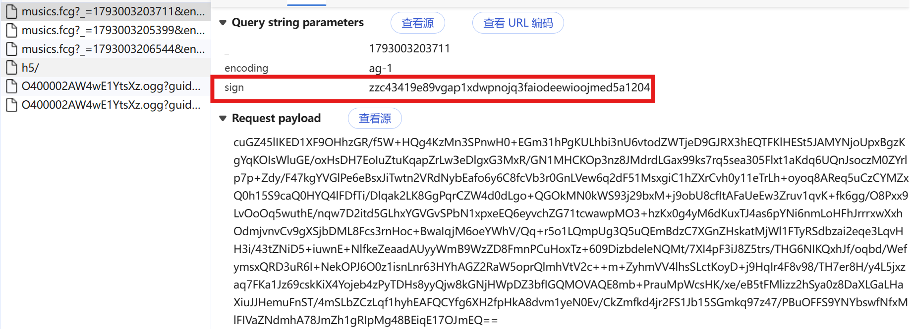
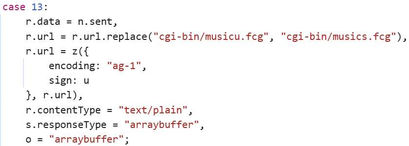
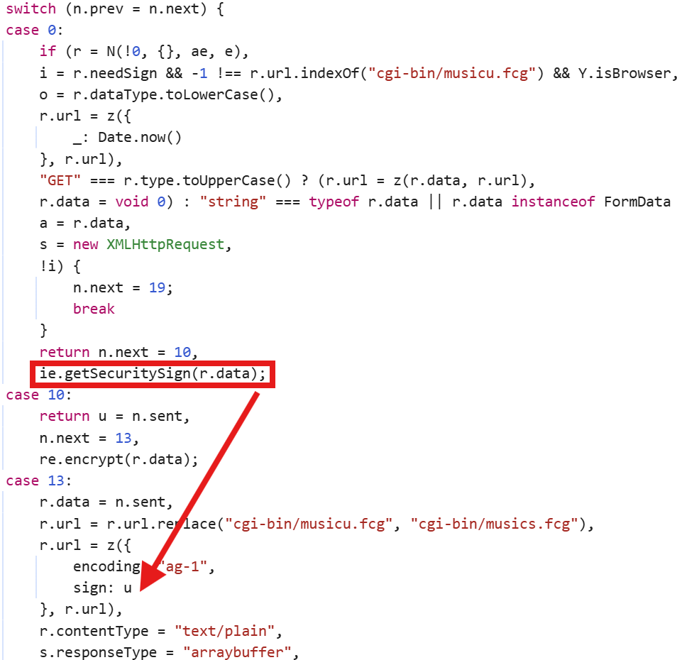
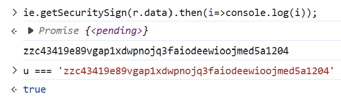
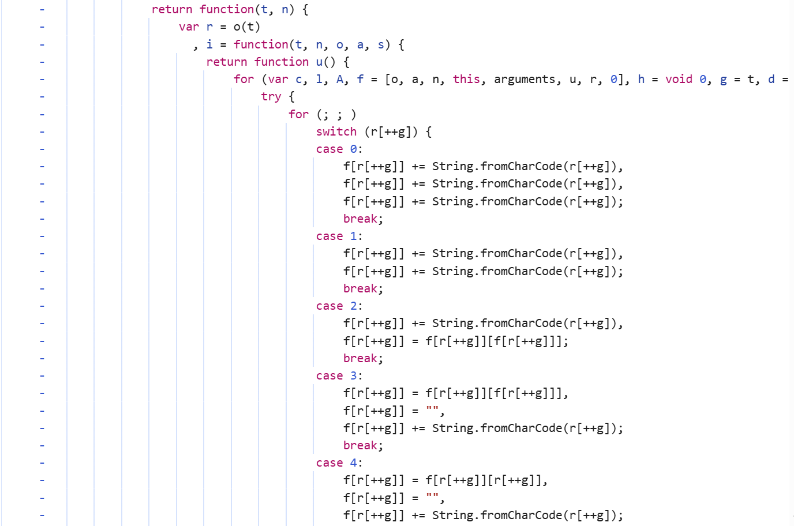
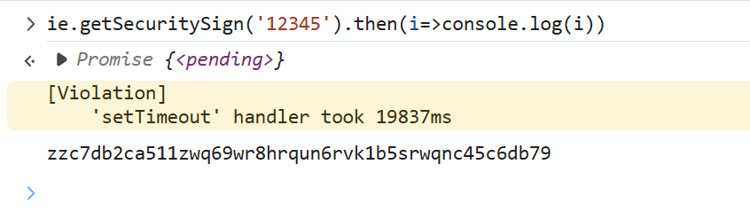
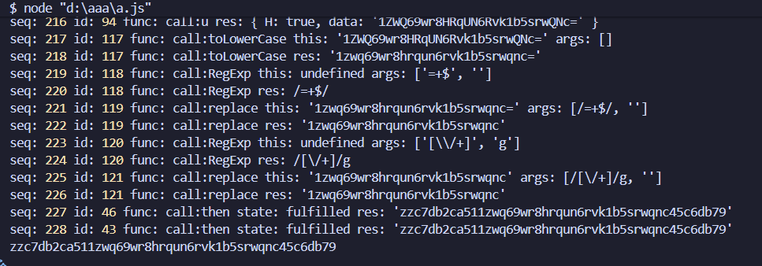
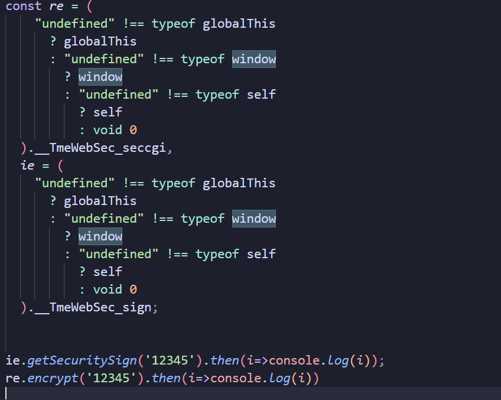

---
title: "JS逆向仓库001:某Q音乐JSVMP纯算逆向(中等)"
author: "Zsx"
pubDatetime: 2026-10-26T00:00:00+08:00
description: "JSVMP逆向"
tags:
  - JS逆向
  - WEB端
  - JSVMP
featured: false
draft: false
---
网址：aHR0cHM6Ly95LnFxLmNvbS8=

接口：aHR0cHM6Ly91Ni55LnFxLmNvbS9jZ2ktYmluL211c2ljcy5mY2c=

# 1.接口分析

随便搜索一首歌，点击播放，打开Devtools开发者工具抓包，如下图所示：



对比多个fcg接口，可以得知这个sign是变化的，所以说这个sign就是我们要逆向的参数，至于短横线就是一个13位的时间戳。
使用全局搜索大法，直接搜索sign。



可以很明显的看出sign是由u赋值的。

这个是一个switch case控制流，我们可以向上追溯u的生成。



可以很明显的发现：ie.getSecuritySign(r.data);其实就是u的生成。

这个是一个异步的方法调用，我们可以在控制台输入：

```
ie.getSecuritySign(r.data).then(i=>console.log(i));
```

通过.then方法，它会返回一个Promise的pending状态。



可以很明显的看到，u确实是ie.getSecuritySign(r.data)这个方法返回的值。

直接进入到这个方法内部，发现它是一个JSVMP。



直接把这整个JSVMP复制下来，可以看到：

```
((function () {
  var e = [];
  function t(e, t, n) {
    for (var r = [], i = 0; i++ < t; ) r.push((e += n));
    return r;
  }
  var n = t(0, 43, 0)
    .concat([62, 0, 62, 0, 63])
    .concat(t(51, 10, 1))
    .concat(t(0, 8, 0))
    .concat(t(0, 25, 1))
    .concat([0, 0, 0, 0, 63, 0])
    .concat(t(25, 26, 1));
  function r(e) {
    for (
      var t,
        r,
        i = String(e).replace(/[=]+$/, ""),
        o = i.length,
        a = 0,
        s = 0,
        u = [];
      s < o;
      s++
    )
      ~(r = n[i.charCodeAt(s)]) &&
        ((t = a % 4 ? 64 * t + r : r), a++ % 4) &&
        u.push(255 & (t >> ((-2 * a) & 6)));
    return u;
  }
  function i(e) {
    return (e >> 1) ^ -(1 & e);
  }
  var o = function (e) {
    for (
      var t = [],
        n = "undefined" != typeof Int8Array ? new Int8Array(r(e)) : r(e),
        o = n.length,
        a = 0;
      o > a;
    ) {
      var s = n[a++],
        u = 127 & s;
      s >= 0
        ? t.push(i(u))
        : ((u |= (127 & (s = n[a++])) << 7),
          s >= 0 ||
            ((u |= (127 & (s = n[a++])) << 14),
            s >= 0 ||
              ((u |= (127 & (s = n[a++])) << 21),
              s >= 0 || (u |= (s = n[a++]) << 28))),
          t.push(i(u)));
    }
    return t;
  };
  return function (t, n) {
    var r = o(t),
      i = function (t, n, o, a, s) {
        return function u() {
          for (
            var c,
              l,
              A,
              f = [o, a, n, this, arguments, u, r, 0],
              h = void 0,
              g = t,
              d = [];
            ;
          )
            try {
              for (;;)
                switch (r[++g]) {
                  case 0:
                    ((f[r[++g]] += String.fromCharCode(r[++g])),
                      (f[r[++g]] += String.fromCharCode(r[++g])),
                      (f[r[++g]] += String.fromCharCode(r[++g])));
                    break;
                  case 1:
                    ((f[r[++g]] += String.fromCharCode(r[++g])),
                      (f[r[++g]] += String.fromCharCode(r[++g])));
                    break;
                  case 2:
                    ((f[r[++g]] += String.fromCharCode(r[++g])),
                      (f[r[++g]] = f[r[++g]][f[r[++g]]]));
                    break;
                  case 3:
                    ((f[r[++g]] = f[r[++g]][f[r[++g]]]),
                      (f[r[++g]] = ""),
                      (f[r[++g]] += String.fromCharCode(r[++g])));
                    break;
                  case 4:
                    ((f[r[++g]] = f[r[++g]][r[++g]]),
                      (f[r[++g]] = ""),
                      (f[r[++g]] += String.fromCharCode(r[++g])));
                    break;
                  case 5:
                    ((f[r[++g]] += String.fromCharCode(r[++g])),
                      (f[r[++g]] = ""),
                      (f[r[++g]] += String.fromCharCode(r[++g])));
                    break;
                  case 6:
                    ((f[r[++g]][f[r[++g]]] = f[r[++g]]),
                      (f[r[++g]] = ""),
                      (f[r[++g]] += String.fromCharCode(r[++g])));
                    break;
                  case 7:
                    ((f[r[++g]][r[++g]] = f[r[++g]]),
                      (f[r[++g]] = r[++g]),
                      (f[r[++g]][r[++g]] = f[r[++g]]));
                    break;
                  case 8:
                    ((f[r[++g]] = ""),
                      (f[r[++g]] += String.fromCharCode(r[++g])));
                    break;
                  case 9:
                    for (
                      f[r[++g]] += String.fromCharCode(r[++g]),
                        l = [],
                        A = r[++g];
                      A > 0;
                      A--
                    )
                      l.push(f[r[++g]]);
                    f[r[++g]] = i(g + r[++g], l, o, a, s);
                    try {
                      Object.defineProperty(f[r[g - 1]], "length", {
                        value: r[++g],
                        configurable: !0,
                        writable: !1,
                        enumerable: !1,
                      });
                    } catch (e) {}
                    f[r[++g]] = f[r[++g]];
                    break;
                  case 10:
                    for (l = [], A = r[++g]; A > 0; A--) l.push(f[r[++g]]);
                    f[r[++g]] = i(g + r[++g], l, o, a, s);
                    try {
                      Object.defineProperty(f[r[g - 1]], "length", {
                        value: r[++g],
                        configurable: !0,
                        writable: !1,
                        enumerable: !1,
                      });
                    } catch (e) {}
                    ((f[r[++g]] = f[r[++g]]),
                      (f[r[++g]][f[r[++g]]] = f[r[++g]]));
                    break;
                  case 11:
                    ((f[r[++g]] = f[r[++g]][r[++g]]),
                      (f[r[++g]] = f[r[++g]][r[++g]]));
                    break;
                  case 12:
                    ((f[r[++g]] = f[r[++g]]),
                      (f[r[++g]][f[r[++g]]] = f[r[++g]]));
                    break;
                  case 13:
                    ((f[r[++g]] = f[r[++g]][f[r[++g]]]),
                      (f[r[++g]] = f[r[++g]][r[++g]]),
                      (f[r[++g]] = ""));
                    break;
                  case 14:
                    ((f[r[++g]] = f[r[++g]] == f[r[++g]]),
                      (f[r[++g]] = !f[r[++g]]),
                      (g += f[r[++g]] ? r[++g] : r[(++g, ++g)]));
                    break;
                  case 15:
                    ((f[r[++g]] = f[r[++g]][f[r[++g]]]),
                      (f[r[++g]] = typeof f[r[++g]]),
                      (f[r[++g]] = f[r[++g]] == f[r[++g]]));
                    break;
                  case 16:
                    ((f[r[++g]] = f[r[++g]][f[r[++g]]]),
                      (f[r[++g]] = f[r[++g]].call(f[r[++g]])));
                    break;
                  case 17:
                    ((f[r[++g]][f[r[++g]]] = f[r[++g]]),
                      (f[r[++g]] = f[r[++g]][r[++g]]),
                      (f[r[++g]] = ""));
                    break;
                  case 18:
                    ((f[r[++g]] = c),
                      (f[r[++g]] = f[r[++g]]),
                      d.push(g + r[++g]));
                    break;
                  case 19:
                    ((f[r[++g]] = typeof f[r[++g]]),
                      (f[r[++g]] = f[r[++g]] == f[r[++g]]),
                      (g += f[r[++g]] ? r[++g] : r[(++g, ++g)]));
                    break;
                  case 20:
                    ((f[r[++g]] = f[r[++g]][f[r[++g]]]),
                      (f[r[++g]] = typeof f[r[++g]]),
                      (f[r[++g]] = ""));
                    break;
                  case 21:
                    ((f[r[++g]] = f[r[++g]] === f[r[++g]]),
                      (f[r[++g]] = !f[r[++g]]),
                      (g += f[r[++g]] ? r[++g] : r[(++g, ++g)]));
                    break;
                  case 22:
                    ((f[r[++g]] = f[r[++g]] ^ f[r[++g]]),
                      (f[r[++g]] = f[r[++g]]),
                      (f[r[++g]] = f[r[++g]]));
                    break;
                  case 23:
                    f[r[++g]] = Array(r[++g]);
                    break;
                  case 24:
                    for (l = [], A = r[++g]; A > 0; A--) l.push(f[r[++g]]);
                    f[r[++g]] = i(g + r[++g], l, o, a, s);
                    try {
                      Object.defineProperty(f[r[g - 1]], "length", {
                        value: r[++g],
                        configurable: !0,
                        writable: !1,
                        enumerable: !1,
                      });
                    } catch (e) {}
                    break;
                  case 25:
                    f[r[++g]][r[++g]] = f[r[++g]];
                    break;
                  case 26:
                    d.push(g + r[++g]);
                    break;
                  case 27:
                    d.pop();
                    break;
                  case 28:
                    g += r[++g];
                    break;
                  case 29:
                    f[r[++g]] = c;
                    break;
                  case 30:
                    throw f[r[++g]];
                  case 31:
                    f[r[++g]] = "";
                    break;
                  case 32:
                    g += f[r[++g]] ? r[++g] : r[(++g, ++g)];
                    break;
                  case 33:
                    f[r[++g]] = f[r[++g]][f[r[++g]]];
                    break;
                  case 34:
                    f[r[++g]] = f[r[++g]][r[++g]];
                    break;
                  case 35:
                    f[r[++g]] = {};
                    break;
                  case 36:
                    f[r[++g]] = f[r[++g]];
                    break;
                  case 37:
                    f[r[++g]] = f[r[++g]].call(h, f[r[++g]]);
                    break;
                  case 38:
                    f[r[++g]] = f[r[++g]].call(h);
                    break;
                  case 39:
                    f[r[++g]] = typeof f[r[++g]];
                    break;
                  case 40:
                    f[r[++g]] += String.fromCharCode(r[++g]);
                    break;
                  case 41:
                    f[r[++g]][f[r[++g]]] = f[r[++g]];
                    break;
                  case 42:
                    f[r[++g]] = h;
                    break;
                  case 43:
                    return f[r[++g]];
                  case 44:
                    f[r[++g]] = f[r[++g]] === r[++g];
                    break;
                  case 45:
                    f[r[++g]] = r[++g];
                    break;
                  case 46:
                    f[r[++g]] = f[r[++g]] < f[r[++g]];
                    break;
                  case 47:
                    f[r[++g]] =
                      "bigint" == typeof f[r[g + 1]]
                        ? f[r[++g]]
                        : f[r[++g]] - 0;
                    break;
                  case 48:
                    f[r[++g]] = ++f[r[++g]];
                    break;
                  case 49:
                    f[r[++g]] = !f[r[++g]];
                    break;
                  case 50:
                    f[r[++g]] = f[r[++g]] in f[r[++g]];
                    break;
                  case 51:
                    f[r[++g]] = f[r[++g]].call(
                      f[r[++g]],
                      f[r[++g]],
                      f[r[++g]],
                      f[r[++g]],
                    );
                    break;
                  case 52:
                    f[r[++g]] = f[r[++g]].call(f[r[++g]], f[r[++g]]);
                    break;
                  case 53:
                    f[r[++g]] = new f[r[++g]](f[r[++g]]);
                    break;
                  case 54:
                    f[r[++g]] = f[r[++g]] + f[r[++g]];
                    break;
                  case 55:
                    f[r[++g]] = null;
                    break;
                  case 56:
                    f[r[++g]] = f[r[++g]] === f[r[++g]];
                    break;
                  case 57:
                    f[r[++g]] = f[r[++g]].call(h, f[r[++g]], f[r[++g]]);
                    break;
                  case 58:
                    f[r[++g]] = new f[r[++g]]();
                    break;
                  case 59:
                    f[r[++g]] = f[r[++g]].call(f[r[++g]], f[r[++g]], f[r[++g]]);
                    break;
                  case 60:
                    f[r[++g]] = f[r[++g]] / f[r[++g]];
                    break;
                  case 61:
                    f[r[++g]] = f[r[++g]] - f[r[++g]];
                    break;
                  case 62:
                    f[r[++g]] = -f[r[++g]];
                    break;
                  case 63:
                    f[r[++g]] = f[r[++g]] > r[++g];
                    break;
                  case 64:
                    f[r[++g]] = f[r[++g]] == f[r[++g]];
                    break;
                  case 65:
                    for (l = [], A = r[++g]; A > 0; A--) l.push(f[r[++g]]);
                    f[r[++g]] = f[r[++g]].apply(f[r[++g]], l);
                    break;
                  case 66:
                    f[r[++g]] = f[r[++g]] >>> r[++g];
                    break;
                  case 67:
                    f[r[++g]] = f[r[++g]] >> r[++g];
                    break;
                  case 68:
                    f[r[++g]] = f[r[++g]] * f[r[++g]];
                    break;
                  case 69:
                    f[r[++g]] = f[r[++g]] & r[++g];
                    break;
                  case 70:
                    f[r[++g]] = f[r[++g]] + r[++g];
                    break;
                  case 71:
                    f[r[++g]] = f[r[++g]] << r[++g];
                    break;
                  case 72:
                    f[r[++g]] = f[r[++g]] | f[r[++g]];
                    break;
                  case 73:
                    f[r[++g]] = f[r[++g]] ^ f[r[++g]];
                    break;
                  case 74:
                    f[r[++g]] = f[r[++g]] >= r[++g];
                    break;
                  case 75:
                    f[r[++g]] = f[r[++g]] | r[++g];
                    break;
                  case 76:
                    f[r[++g]] = f[r[++g]].call(f[r[++g]]);
                    break;
                  case 77:
                    f[r[++g]] = f[r[++g]] < r[++g];
                    break;
                  case 78:
                    f[r[++g]] = f[r[++g]] % f[r[++g]];
                    break;
                  case 79:
                    f[r[++g]] = f[r[++g]].call(
                      h,
                      f[r[++g]],
                      f[r[++g]],
                      f[r[++g]],
                    );
                    break;
                  case 80:
                    f[r[++g]] = new f[r[++g]](f[r[++g]], f[r[++g]]);
                }
            } catch (t) {
              if (
                (d.length > 0 && (e = []), (c = t), e.push(g), 0 === d.length)
              )
                throw s ? s(t, f, e) : t;
              ((g = d.pop()), e.pop());
            }
        };
      };
    return n ? void 0 : i;
  };
})()(
  "",
  !1,
)(
  -1,
  [],
  {
    get SuppressedError() {
      return "undefined" == typeof SuppressedError ? void 0 : SuppressedError;
    },
    get globalThis() {
      return "undefined" == typeof globalThis ? void 0 : globalThis;
    },
    get window() {
      return "undefined" == typeof window ? void 0 : window;
    },
    get self() {
      return "undefined" == typeof self ? void 0 : self;
    },
    get Array() {
      return "undefined" == typeof Array ? void 0 : Array;
    },
    get Uint8Array() {
      return "undefined" == typeof Uint8Array ? void 0 : Uint8Array;
    },
    get String() {
      return "undefined" == typeof String ? void 0 : String;
    },
    get Promise() {
      return "undefined" == typeof Promise ? void 0 : Promise;
    },
    get document() {
      return "undefined" == typeof document ? void 0 : document;
    },
    get RegExp() {
      return "undefined" == typeof RegExp ? void 0 : RegExp;
    },
    get TextEncoder() {
      return "undefined" == typeof TextEncoder ? void 0 : TextEncoder;
    },
    get TextDecoder() {
      return "undefined" == typeof TextDecoder ? void 0 : TextDecoder;
    },
    get crypto() {
      return "undefined" == typeof crypto ? void 0 : crypto;
    },
    get Symbol() {
      return "undefined" == typeof Symbol ? void 0 : Symbol;
    },
    get navigator() {
      return "undefined" == typeof navigator ? void 0 : navigator;
    },
    get Date() {
      return "undefined" == typeof Date ? void 0 : Date;
    },
    get Intl() {
      return "undefined" == typeof Intl ? void 0 : Intl;
    },
    get screen() {
      return "undefined" == typeof screen ? void 0 : screen;
    },
    get Float32Array() {
      return "undefined" == typeof Float32Array ? void 0 : Float32Array;
    },
    get matchMedia() {
      return "undefined" == typeof matchMedia ? void 0 : matchMedia;
    },
    get Function() {
      return "undefined" == typeof Function ? void 0 : Function;
    },
    get Object() {
      return "undefined" == typeof Object ? void 0 : Object;
    },
    get btoa() {
      return "undefined" == typeof btoa ? void 0 : btoa;
    },
    get Math() {
      return "undefined" == typeof Math ? void 0 : Math;
    },
    get parseInt() {
      return "undefined" == typeof parseInt ? void 0 : parseInt;
    },
    get JSON() {
      return "undefined" == typeof JSON ? void 0 : JSON;
    },
    get location() {
      return "undefined" == typeof location ? void 0 : location;
    },
    get Blob() {
      return "undefined" == typeof Blob ? void 0 : Blob;
    },
    get fetch() {
      return "undefined" == typeof fetch ? void 0 : fetch;
    },
  },
  [
    void 0,
    null,
    3432918353,
    3864292196,
    2869860233,
    2716044179,
    1444728091,
    2530024501,
    2246822507,
    3266489909,
    3735928559,
  ],
  void 0,
)(),
  ("undefined" !== typeof globalThis
    ? globalThis
    : "undefined" !== typeof window
      ? window
      : "undefined" !== typeof self
        ? self
        : void 0
  ).__TmeWebSec_U,
  ("undefined" !== typeof globalThis
    ? globalThis
    : "undefined" !== typeof window
      ? window
      : "undefined" !== typeof self
        ? self
        : void 0
  ).__TmeWebSec_I,
  ("undefined" !== typeof globalThis
    ? globalThis
    : "undefined" !== typeof window
      ? window
      : "undefined" !== typeof self
        ? self
        : void 0
  ).__TmeWebSec_M,
  ("undefined" !== typeof globalThis
    ? globalThis
    : "undefined" !== typeof window
      ? window
      : "undefined" !== typeof self
        ? self
        : void 0
  ).__TmeWebSec_x);
const ne = (
  "undefined" !== typeof globalThis
    ? globalThis
    : "undefined" !== typeof window
      ? window
      : "undefined" !== typeof self
        ? self
        : void 0
).__TmeWebSec_D;
(("undefined" !== typeof globalThis
  ? globalThis
  : "undefined" !== typeof window
    ? window
    : "undefined" !== typeof self
      ? self
      : void 0
).__TmeWebSec_fingerprint,
  ("undefined" !== typeof globalThis
    ? globalThis
    : "undefined" !== typeof window
      ? window
      : "undefined" !== typeof self
        ? self
        : void 0
  ).__TmeWebSec_report);
const re = (
    "undefined" !== typeof globalThis
      ? globalThis
      : "undefined" !== typeof window
        ? window
        : "undefined" !== typeof self
          ? self
          : void 0
  ).__TmeWebSec_seccgi,
  ie = (
    "undefined" !== typeof globalThis
      ? globalThis
      : "undefined" !== typeof window
        ? window
        : "undefined" !== typeof self
          ? self
          : void 0
  ).__TmeWebSec_sign;
```

这个其实就是算出sign的JSVMP了。最底下有一个：

```
ie = (
    "undefined" !== typeof globalThis
      ? globalThis
      : "undefined" !== typeof window
        ? window
        : "undefined" !== typeof self
          ? self
          : void 0
  ).__TmeWebSec_sign;

该JSVMP样本为2026.10.26的版本.
```
我们可以通过调用ie.getSecuritySign()方法拿到一个sign的测试值。

```
ie.getSecuritySign('12345').then(i=>console.log(i));
// 会输出：zzc06238839gcc1zjxcyhecs92sqqtqrqd4hc510d64ca
```

现在这个JSVMP已经跑起来了，不过现在拿到的值肯定是假的值。

我们下一步还需要对这个JSVMP进行插桩，通过看log日志的方法分析这个VMP的来龙去脉。

# 2.VMP插桩

这个VMP的特征其实非常明显，它是一个栈式虚拟机。

我们可以先通过在VMP的解释器处，对call、apply处进行插桩分析。

ctrl+f搜索一下，call+apply一共10处调用。

把这10处都插上桩。

# 3.插桩代码参考
```
const { log } = require('console');
const { inspect } = require('node:util');
const { JSDOM, VirtualConsole } = require('jsdom');
const fs = require('node:fs');
const dom = new JSDOM('', {
    url: "https://example.com/",
    pretendToBeVisual: true,
    virtualConsole: new VirtualConsole(),
    // runScripts: "outside-only"
});
const window = dom.window;

const logConfig = {
    common: true,
    opCode: true,
    promise: true
}

let __seq = 0
let __logSeq = 0
let __pendingConcat = null; // Pending "+=" log aggregation.

function __inspectValue(value) {
    try {
        return inspect(value, {
            depth: 3,
            breakLength: Infinity,
            compact: true,
            maxArrayLength: 64,
            maxStringLength: 500,
            getters: false,
        });
    } catch (error) {
        return `<uninspectable: ${error && error.message || error}>`;
    }
}

function __inspectArgs(args) {
    if (!Array.isArray(args)) return __inspectValue(args);
    const values = args.map(function (value) {
        return value === window ? "window" : __inspectValue(value);
    });
    return "[" + values.join(", ") + "]";
}

function __functionName(func) {
    if (typeof func !== "function") {
        return __inspectValue(func);
    }
    try {
        if (func.name) return func.name;
    } catch {}
    try {
        const source = Function.prototype.toString.call(func);
        const match =
            source.match(/^\s*(?:async\s+)?function\s+([^\s(]+)/) ||
            source.match(/^\s*(?:async\s*)?([^\s(=]+)\s*\(/);
        if (match && match[1]) return match[1];
    } catch {}
    return "<anonymous>";
}

function __isPromiseLike(value) {
    if (
        value === null ||
        (typeof value !== "object" && typeof value !== "function")
    ) {
        return false;
    }
    try {
        return typeof value.then === "function";
    } catch {
        return false;
    }
}

function flushPendingConcat() {
    if (!__pendingConcat) return;
    const pending = __pendingConcat;
    __pendingConcat = null;
    log("seq:", ++__logSeq, "id:", pending.id, "运算符:", "+=", "args:", JSON.stringify(pending.args), "res:", JSON.stringify(pending.res));
}

function prevLog(func, t, args) {
    flushPendingConcat();
    if (!logConfig.common) return;
    const id = ++__seq;
    const thisText = t === window ? "window" : __inspectValue(t);
    log("seq:", ++__logSeq, "id:", id, "func:", func, "this:", thisText, "args:", __inspectArgs(args));
    return {id, func};
}

function nextLog(id, func, res, state) {
    flushPendingConcat();
    if (!logConfig.common) return;
    if (state) {
        log("seq:", ++__logSeq, "id:", id, "func:", func, "state:", state, "res:", __inspectValue(res));
    } else {
        log("seq:", ++__logSeq, "id:", id, "func:", func, "res:", __inspectValue(res));
    }
    return res;
}

function observePromise(id, func, promise) {
    if (!logConfig.common || !logConfig.promise || !__isPromiseLike(promise)) return;
    Promise.resolve(promise).then(
        function (value) {
            nextLog(id, func, value, "fulfilled");
        },
        function (reason) {
            nextLog(id, func, reason, "rejected");
        },
    );
}

function __traceVmInvoke(opcode, func, thisArg, args) {
    const funcName = __functionName(func);
    const ctx = prevLog(opcode + ":" + funcName, thisArg, args);
    const res =
        opcode === "apply"
            ? func.apply(thisArg, args)
            : func.call(thisArg, ...args);
    const pending = __isPromiseLike(res);
    if (ctx) {
        nextLog(ctx.id, ctx.func, res, pending ? "pending" : undefined);
    }
    if (pending && ctx) {
        observePromise(ctx.id, ctx.func, res);
    }
    return res;
}

function prevOpCode(opcode, args) {
    if (!logConfig.opCode) return;
    if (opcode !== "+=") flushPendingConcat();
    const id = ++__seq;
    return { id, opcode, args };
}

function nextOpCode(ctx, res) {
    if (!logConfig.opCode) return res;
    if (ctx.opcode === "+=") {
        if (__pendingConcat && __pendingConcat.res === ctx.args[0]) {
            __pendingConcat.args[1] += ctx.args[1];
            __pendingConcat.res = res;
            __pendingConcat.count++;
        } else {
            flushPendingConcat();
            __pendingConcat = {
                id: ctx.id,
                args: [ctx.args[0], ctx.args[1]],
                res,
                count: 1,
            };
        }
        return res;
    }
    flushPendingConcat();
    log("seq:", ++__logSeq, "id:", ctx.id, "运算符:", ctx.opcode, "args:", JSON.stringify(ctx.args), "res:", JSON.stringify(res));
    return res;
}
```

# 4.call,apply处插桩日志分析
对JSVMP解释器的call,apply处插桩

在终端输入:**node.exe a.js > vm.log 2>&1**
日志会被保存到vm.log文件中,方便分析

插桩日志:
```
seq: 1 id: 1 func: call:u this: undefined args: [{}]
seq: 2 id: 1 func: call:u res: undefined
seq: 3 id: 2 func: call:u this: undefined args: []
seq: 4 id: 2 func: call:u res: { [Function: u] o: [Function: u], v: [Function: u], p: [Function: u], h: [Function: u], l: [Function: u], T: [Function: u], m: [Function: u], _: [Function: u], U: [Function: u], S: [Function: u], F: [Function: u], A: [Function: u], M: [Function: u], j: [Function: u], P: [Function: u], I: [Function: u] }
seq: 5 id: 3 func: call:u this: undefined args: []
seq: 6 id: 3 func: call:u res: { [Function: u] D: [Function: u] }
seq: 7 id: 4 func: call:u this: undefined args: []
seq: 8 id: 4 func: call:u res: { [Function: u] C: [Function: u] }
seq: 9 id: 5 func: call:u this: undefined args: []
seq: 10 id: 5 func: call:u res: { [Function: u] q: [Function: u] }
seq: 11 id: 6 func: call:u this: undefined args: []
seq: 12 id: 6 func: call:u res: { [Function: u] R: [Function: u], '$': [Function: u] }
seq: 13 id: 7 func: call:u this: undefined args: []
seq: 14 id: 7 func: call:u res: { [Function: u] k: [Function: u] }
seq: 15 id: 8 func: call:u this: undefined args: []
seq: 16 id: 8 func: call:u res: { [Function: u] N: [Function: u] }
seq: 17 id: 9 func: call:u this: undefined args: []
seq: 18 id: 9 func: call:u res: { [Function: u] O: [Function: u] }
seq: 19 id: 10 func: call:u this: undefined args: []
seq: 20 id: 10 func: call:u res: { [Function: u] B: [Function: u] }
seq: 21 id: 11 func: call:u this: undefined args: []
seq: 22 id: 11 func: call:u res: { [Function: u] M: [Function: u], K: [Function: u], L: [Function: u], G: [Function: u] }
seq: 23 id: 12 func: call:u this: undefined args: []
seq: 24 id: 12 func: call:u res: { [Function: u] getInstance: [Function: u] }
seq: 25 id: 13 func: call:u this: undefined args: []
seq: 26 id: 13 func: call:u res: { [Function: u] getInstance: [Function: u] }
seq: 27 id: 14 func: call:u this: undefined args: []
seq: 28 id: 14 func: call:u res: { [Function: u] X: [Function: u], Y: [Function: u], Z: [Function: u], nn: [Function: u], V: [Function: u] }
seq: 29 id: 15 func: call:u this: undefined args: []
seq: 30 id: 15 func: call:u res: { [Function: u] get: [Function: u], set: [Function: u], remove: [Function: u] }
seq: 31 id: 16 func: call:u this: undefined args: []
seq: 32 id: 16 func: call:u res: { [Function: u] getInstance: [Function: u], gn: [Function: u], hn: [Function: u], an: '_tme_did', Un: 365, sn: '|||', yn: 'secid', pn: 1, wn: 4, En: 'T$m3_S3c_2024!xK9' }
seq: 33 id: 17 func: call:u this: undefined args: []
seq: 34 id: 17 func: call:u res: { [Function: u] getInstance: [Function: u], jn: [Function: u], hn: [Function: u], Pn: [Function: u], In: [Function: u], an: '_tme_cid', Un: 365, yn: 'cid', pn: 1, wn: 4, En: 'T$m3_S3c_2024!xK9', Dn: 0 }
seq: 35 id: 18 func: call:u this: undefined args: []
seq: 36 id: 18 func: call:u res: { [Function: u] Cn: [Function: u], Nn: [Function: u], Wn: { Hn: 'T0', Xn: 'T1', Zn: 'T2', Qn: 'T3', Vn: 'T4', Yn: 'T5', nt: 'T6', tt: 'T7', rt: 'T8', et: 'T9', it: 'T10', ut: 'T11', ot: 'T12', ft: 'T13', ct: 'T14', dt: 'T15', vt: 'T16', st: 'T17', yt: 'T18', ht: 'T19', gt: 'T20', wt: 'T100', lt: 'T101', Et: 'T102', Tt: 'T103', _t: 'T104', Ut: 'T105', St: 'T106', bt: 'T122', Ft: 'T124', At: 'T200', xt: 'T201' }, qn: [ 138, 61, 226, 151 ], Rn: [ 91, 199, 20, 248 ], '$n': [ 105, 163, 208, 78 ], kn: [ 39, 159, 60, 178 ], On: [ 241, 93, 139, 35 ], Bn: [ 166, 55, 206, 72 ], Kn: [ 146, 122, 229, 27 ], Ln: [ 60, 132, 111, 217 ] }
seq: 37 id: 19 func: call:u this: undefined args: []
seq: 38 id: 19 func: call:u res: [Function: u]
seq: 39 id: 20 func: call:u this: undefined args: []
seq: 40 id: 20 func: call:u res: { [Function: u] qt: [Function: u], d: [Function: u], Rt: [Function: u], w: [Function: u], e: [Function: u], level: 0, '$t': '[TMESec]' }
seq: 41 id: 21 func: call:u this: undefined args: []
seq: 42 id: 21 func: call:u res: { [Function: u] getInstance: [Function: u], kt: 'FingerprintModule' }
seq: 43 id: 22 func: call:u this: undefined args: []
seq: 44 id: 22 func: call:u res: { [Function: u] Ot: [Function: u], Bt: [ 'qq.com', 'joox.com', 'tencentmusic.com', 'wavecommittee.com', 'kugou.com', 'kuwo.cn' ] }
seq: 45 id: 23 func: call:u this: undefined args: []
seq: 46 id: 23 func: call:u res: { [Function: u] getInstance: [Function: u], kt: 'SignModule' }
seq: 47 id: 24 func: call:u this: undefined args: []
seq: 48 id: 24 func: call:u res: { [Function: u] getInstance: [Function: u], kt: 'SecCgiModule' }
seq: 49 id: 25 func: call:u this: undefined args: []
seq: 50 id: 25 func: call:u res: { [Function: u] Kt: [Function: u], Lt: [Function: u] }
seq: 51 id: 26 func: call:u this: undefined args: []
seq: 52 id: 26 func: call:u res: { [Function: u] getInstance: [Function: u], Jt: 'https://t.y.qq.com/cgi-bin/musicu.fcg' }
seq: 53 id: 27 func: call:u this: undefined args: []
seq: 54 id: 27 func: call:u res: { [Function: u] getInstance: [Function: u], Wt: [Function: u], kt: 'TMESec', isInitialized: false }
seq: 55 id: 28 func: call:u this: { [Function: u] getInstance: [Function: u], kt: 'FingerprintModule' } args: []
seq: 56 id: 29 func: call:u this: { [Function: u] qt: [Function: u], d: [Function: u], Rt: [Function: u], w: [Function: u], e: [Function: u], level: 0, '$t': '[TMESec]' } args: ['FingerprintModule', 'Fingerprint 模块初始化中...']
seq: 57 id: 29 func: call:u res: undefined
seq: 58 id: 30 func: call:u this: u { Mt: '', jt: -1, Pt: -1, It: false, Dt: '1' } args: []
seq: 59 id: 30 func: call:u res: undefined
seq: 60 id: 31 func: call:u this: { [Function: u] qt: [Function: u], d: [Function: u], Rt: [Function: u], w: [Function: u], e: [Function: u], level: 0, '$t': '[TMESec]' } args: ['FingerprintModule', 'Fingerprint 模块初始化成功']
seq: 61 id: 31 func: call:u res: undefined
seq: 62 id: 28 func: call:u res: u { version: '0.0.1', Nt: u { Mt: '', jt: -1, Pt: -1, It: true, Dt: '1' } }
seq: 63 id: 32 func: call:u this: { [Function: u] getInstance: [Function: u], kt: 'SignModule' } args: []
seq: 64 id: 33 func: call:u this: { [Function: u] qt: [Function: u], d: [Function: u], Rt: [Function: u], w: [Function: u], e: [Function: u], level: 0, '$t': '[TMESec]' } args: ['SignModule', 'Sign 模块初始化中...']
seq: 65 id: 33 func: call:u res: undefined
seq: 66 id: 32 func: call:u res: u { version: '0.0.1' }
seq: 67 id: 34 func: call:u this: { [Function: u] getInstance: [Function: u], kt: 'SecCgiModule' } args: []
seq: 68 id: 35 func: call:u this: { [Function: u] qt: [Function: u], d: [Function: u], Rt: [Function: u], w: [Function: u], e: [Function: u], level: 0, '$t': '[TMESec]' } args: ['SecCgiModule', 'SecCgi 模块初始化中...']
seq: 69 id: 35 func: call:u res: undefined
seq: 70 id: 34 func: call:u res: u { version: '0.0.1' }
seq: 71 id: 36 func: call:u this: { [Function: u] getInstance: [Function: u], Jt: 'https://t.y.qq.com/cgi-bin/musicu.fcg' } args: []
seq: 72 id: 37 func: call:u this: { [Function: u] qt: [Function: u], d: [Function: u], Rt: [Function: u], w: [Function: u], e: [Function: u], level: 0, '$t': '[TMESec]' } args: ['ReportModule', 'Report 模块初始化中...']
seq: 73 id: 37 func: call:u res: undefined
seq: 74 id: 36 func: call:u res: u { transport: u {}, Gt: null }
seq: 75 id: 38 func: call:u this: undefined args: []
seq: 76 id: 39 func: call:function this: undefined args: [true]
seq: 77 id: 39 func: call:function res: undefined
seq: 78 id: 38 func: call:u state: pending res: Promise { true }
seq: 79 id: 40 func: call:u this: undefined args: []
seq: 80 id: 41 func: call:function this: undefined args: [true]
seq: 81 id: 41 func: call:function res: undefined
seq: 82 id: 40 func: call:u state: pending res: Promise { true }
seq: 83 id: 42 func: call:all this: [Function: Promise] args: [[ Promise { true }, Promise { true } ]]
seq: 84 id: 42 func: call:all state: pending res: Promise { <pending> }
seq: 85 id: 43 func: call:then this: Promise { <pending> } args: [[Function: u]]
seq: 86 id: 43 func: call:then state: pending res: Promise { <pending> }
seq: 87 id: 38 func: call:u state: fulfilled res: true
seq: 88 id: 40 func: call:u state: fulfilled res: true
seq: 89 id: 42 func: call:all state: fulfilled res: [ true, true ]
seq: 90 id: 44 func: call:encode this: { encoding: 'utf-8' } args: ['12345']
seq: 91 id: 44 func: call:encode res: Uint8Array(5) [ 49, 50, 51, 52, 53 ]
seq: 92 id: 45 func: call:digest this: SubtleCrypto {} args: ['SHA-1', Uint8Array(5) [ 49, 50, 51, 52, 53 ]]
seq: 93 id: 45 func: call:digest state: pending res: Promise { <pending> }
seq: 94 id: 46 func: call:then this: Promise { <pending> } args: [[Function: u]]
seq: 95 id: 46 func: call:then state: pending res: Promise { <pending> }
seq: 96 id: 45 func: call:digest state: fulfilled res: ArrayBuffer { [Uint8Contents]: <8c b2 23 7d 06 79 ca 88 db 64 64 ea c6 0d a9 63 45 51 39 64>, [byteLength]: 20 }
seq: 97 id: 47 func: call:u this: { [Function: u] Ot: [Function: u], Bt: [ 'qq.com', 'joox.com', 'tencentmusic.com', 'wavecommittee.com', 'kugou.com', 'kuwo.cn' ] } args: []
seq: 98 id: 48 func: call:u this: undefined args: [window]
seq: 99 id: 48 func: call:u res: 'object'
seq: 100 id: 49 func: call:u this: undefined args: [Navigator {}]
seq: 101 id: 49 func: call:u res: 'object'
seq: 102 id: 47 func: call:u res: 'FE'
seq: 103 id: 50 func: call:map this: [ 3, 1, 6, 17 ] args: [[Function: u]]
seq: 104 id: 51 func: call:toString this: 6 args: [16]
seq: 105 id: 51 func: call:toString res: '6'
seq: 106 id: 52 func: call:padStart this: '6' args: [2, '0']
seq: 107 id: 52 func: call:padStart res: '06'
seq: 108 id: 53 func: call:toString this: 35 args: [16]
seq: 109 id: 53 func: call:toString res: '23'
seq: 110 id: 54 func: call:padStart this: '23' args: [2, '0']
seq: 111 id: 54 func: call:padStart res: '23'
seq: 112 id: 55 func: call:toString this: 136 args: [16]
seq: 113 id: 55 func: call:toString res: '88'
seq: 114 id: 56 func: call:padStart this: '88' args: [2, '0']
seq: 115 id: 56 func: call:padStart res: '88'
seq: 116 id: 57 func: call:toString this: 57 args: [16]
seq: 117 id: 57 func: call:toString res: '39'
seq: 118 id: 58 func: call:padStart this: '39' args: [2, '0']
seq: 119 id: 58 func: call:padStart res: '39'
seq: 120 id: 50 func: call:map res: [ '06', '23', '88', '39' ]
seq: 121 id: 59 func: call:join this: [ '06', '23', '88', '39' ] args: ['']
seq: 122 id: 59 func: call:join res: '06238839'
seq: 123 id: 60 func: call:map this: [ 16, 12, 8, 5 ] args: [[Function: u]]
seq: 124 id: 61 func: call:toString this: 81 args: [16]
seq: 125 id: 61 func: call:toString res: '51'
seq: 126 id: 62 func: call:padStart this: '51' args: [2, '0']
seq: 127 id: 62 func: call:padStart res: '51'
seq: 128 id: 63 func: call:toString this: 13 args: [16]
seq: 129 id: 63 func: call:toString res: 'd'
seq: 130 id: 64 func: call:padStart this: 'd' args: [2, '0']
seq: 131 id: 64 func: call:padStart res: '0d'
seq: 132 id: 65 func: call:toString this: 100 args: [16]
seq: 133 id: 65 func: call:toString res: '64'
seq: 134 id: 66 func: call:padStart this: '64' args: [2, '0']
seq: 135 id: 66 func: call:padStart res: '64'
seq: 136 id: 67 func: call:toString this: 202 args: [16]
seq: 137 id: 67 func: call:toString res: 'ca'
seq: 138 id: 68 func: call:padStart this: 'ca' args: [2, '0']
seq: 139 id: 68 func: call:padStart res: 'ca'
seq: 140 id: 60 func: call:map res: [ '51', '0d', '64', 'ca' ]
seq: 141 id: 69 func: call:join this: [ '51', '0d', '64', 'ca' ] args: ['']
seq: 142 id: 69 func: call:join res: '510d64ca'
seq: 143 id: 70 func: call:u this: { [Function: u] getInstance: [Function: u] } args: []
seq: 144 id: 70 func: call:u res: u {}
seq: 145 id: 71 func: call:u this: u {} args: [Uint8Array(20) [ 25, 192, 181, 206, 60, 92, 96, 119, 190, 114, 207, 118, 73, 4, 19, 65, 26, 157, 224, 119 ]]
seq: 146 id: 72 func: call:u this: undefined args: [Uint8Array(20) [ 25, 192, 181, 206, 60, 92, 96, 119, 190, 114, 207, 118, 73, 4, 19, 65, 26, 157, 224, 119 ]]
seq: 147 id: 73 func: call:fromCharCode this: [Function: String] args: [25]
seq: 148 id: 73 func: call:fromCharCode res: '\x19'
seq: 149 id: 74 func: call:fromCharCode this: [Function: String] args: [192]
seq: 150 id: 74 func: call:fromCharCode res: 'À'
seq: 151 id: 75 func: call:fromCharCode this: [Function: String] args: [181]
seq: 152 id: 75 func: call:fromCharCode res: 'µ'
seq: 153 id: 76 func: call:fromCharCode this: [Function: String] args: [206]
seq: 154 id: 76 func: call:fromCharCode res: 'Î'
seq: 155 id: 77 func: call:fromCharCode this: [Function: String] args: [60]
seq: 156 id: 77 func: call:fromCharCode res: '<'
seq: 157 id: 78 func: call:fromCharCode this: [Function: String] args: [92]
seq: 158 id: 78 func: call:fromCharCode res: '\\'
seq: 159 id: 79 func: call:fromCharCode this: [Function: String] args: [96]
seq: 160 id: 79 func: call:fromCharCode res: '`'
seq: 161 id: 80 func: call:fromCharCode this: [Function: String] args: [119]
seq: 162 id: 80 func: call:fromCharCode res: 'w'
seq: 163 id: 81 func: call:fromCharCode this: [Function: String] args: [190]
seq: 164 id: 81 func: call:fromCharCode res: '¾'
seq: 165 id: 82 func: call:fromCharCode this: [Function: String] args: [114]
seq: 166 id: 82 func: call:fromCharCode res: 'r'
seq: 167 id: 83 func: call:fromCharCode this: [Function: String] args: [207]
seq: 168 id: 83 func: call:fromCharCode res: 'Ï'
seq: 169 id: 84 func: call:fromCharCode this: [Function: String] args: [118]
seq: 170 id: 84 func: call:fromCharCode res: 'v'
seq: 171 id: 85 func: call:fromCharCode this: [Function: String] args: [73]
seq: 172 id: 85 func: call:fromCharCode res: 'I'
seq: 173 id: 86 func: call:fromCharCode this: [Function: String] args: [4]
seq: 174 id: 86 func: call:fromCharCode res: '\x04'
seq: 175 id: 87 func: call:fromCharCode this: [Function: String] args: [19]
seq: 176 id: 87 func: call:fromCharCode res: '\x13'
seq: 177 id: 88 func: call:fromCharCode this: [Function: String] args: [65]
seq: 178 id: 88 func: call:fromCharCode res: 'A'
seq: 179 id: 89 func: call:fromCharCode this: [Function: String] args: [26]
seq: 180 id: 89 func: call:fromCharCode res: '\x1A'
seq: 181 id: 90 func: call:fromCharCode this: [Function: String] args: [157]
seq: 182 id: 90 func: call:fromCharCode res: '\x9D'
seq: 183 id: 91 func: call:fromCharCode this: [Function: String] args: [224]
seq: 184 id: 91 func: call:fromCharCode res: 'à'
seq: 185 id: 92 func: call:fromCharCode this: [Function: String] args: [119]
seq: 186 id: 92 func: call:fromCharCode res: 'w'
seq: 187 id: 72 func: call:u res: '\x19ÀµÎ<\\`w¾rÏvI\x04\x13A\x1A\x9Dàw'
seq: 188 id: 93 func: call:btoa this: undefined args: ['\x19ÀµÎ<\\`w¾rÏvI\x04\x13A\x1A\x9Dàw']
seq: 189 id: 93 func: call:btoa res: 'GcC1zjxcYHe+cs92SQQTQRqd4Hc='
seq: 190 id: 71 func: call:u res: { H: true, data: 'GcC1zjxcYHe+cs92SQQTQRqd4Hc=' }
seq: 191 id: 94 func: call:toLowerCase this: 'GcC1zjxcYHe+cs92SQQTQRqd4Hc=' args: []
seq: 192 id: 94 func: call:toLowerCase res: 'gcc1zjxcyhe+cs92sqqtqrqd4hc='
seq: 193 id: 95 func: call:RegExp this: undefined args: ['=+$', '']
seq: 194 id: 95 func: call:RegExp res: /=+$/
seq: 195 id: 96 func: call:replace this: 'gcc1zjxcyhe+cs92sqqtqrqd4hc=' args: [/=+$/, '']
seq: 196 id: 96 func: call:replace res: 'gcc1zjxcyhe+cs92sqqtqrqd4hc'
seq: 197 id: 97 func: call:RegExp this: undefined args: ['[\\/+]', 'g']
seq: 198 id: 97 func: call:RegExp res: /[\/+]/g
seq: 199 id: 98 func: call:replace this: 'gcc1zjxcyhe+cs92sqqtqrqd4hc' args: [/[\/+]/g, '']
seq: 200 id: 98 func: call:replace res: 'gcc1zjxcyhecs92sqqtqrqd4hc'
seq: 201 id: 46 func: call:then state: fulfilled res: 'zzc06238839gcc1zjxcyhecs92sqqtqrqd4hc510d64ca'
seq: 202 id: 43 func: call:then state: fulfilled res: 'zzc06238839gcc1zjxcyhecs92sqqtqrqd4hc510d64ca'
zzc06238839gcc1zjxcyhecs92sqqtqrqd4hc510d64ca
```
日志非常少,200行,非常方便观察分析.

这里最后的**zzc06238839gcc1zjxcyhecs92sqqtqrqd4hc510d64ca**其实就是sign值.当前现在的sign值是假值,因为没有过环境检测,走的是错误的JSVMP分支.这个我们后续再说,先进行分析.

首先我先说下,sign其实由4部分组成:
**固定前缀:zzc + 开头段 + 中间段 +结尾段**

# 5.中间段生成
我们这里先看中间段,从日志最底部开始分析.

```
seq: 145 id: 71 func: call:u this: u {} args: [Uint8Array(20) [ 25, 192, 181, 206, 60, 92, 96, 119, 190, 114, 207, 118, 73, 4, 19, 65, 26, 157, 224, 119 ]]
seq: 146 id: 72 func: call:u this: undefined args: [Uint8Array(20) [ 25, 192, 181, 206, 60, 92, 96, 119, 190, 114, 207, 118, 73, 4, 19, 65, 26, 157, 224, 119 ]]
seq: 147 id: 73 func: call:fromCharCode this: [Function: String] args: [25]
seq: 148 id: 73 func: call:fromCharCode res: '\x19'
seq: 149 id: 74 func: call:fromCharCode this: [Function: String] args: [192]
seq: 150 id: 74 func: call:fromCharCode res: 'À'
seq: 151 id: 75 func: call:fromCharCode this: [Function: String] args: [181]
seq: 152 id: 75 func: call:fromCharCode res: 'µ'
seq: 153 id: 76 func: call:fromCharCode this: [Function: String] args: [206]
seq: 154 id: 76 func: call:fromCharCode res: 'Î'
seq: 155 id: 77 func: call:fromCharCode this: [Function: String] args: [60]
seq: 156 id: 77 func: call:fromCharCode res: '<'
seq: 157 id: 78 func: call:fromCharCode this: [Function: String] args: [92]
seq: 158 id: 78 func: call:fromCharCode res: '\\'
seq: 159 id: 79 func: call:fromCharCode this: [Function: String] args: [96]
seq: 160 id: 79 func: call:fromCharCode res: '`'
seq: 161 id: 80 func: call:fromCharCode this: [Function: String] args: [119]
seq: 162 id: 80 func: call:fromCharCode res: 'w'
seq: 163 id: 81 func: call:fromCharCode this: [Function: String] args: [190]
seq: 164 id: 81 func: call:fromCharCode res: '¾'
seq: 165 id: 82 func: call:fromCharCode this: [Function: String] args: [114]
seq: 166 id: 82 func: call:fromCharCode res: 'r'
seq: 167 id: 83 func: call:fromCharCode this: [Function: String] args: [207]
seq: 168 id: 83 func: call:fromCharCode res: 'Ï'
seq: 169 id: 84 func: call:fromCharCode this: [Function: String] args: [118]
seq: 170 id: 84 func: call:fromCharCode res: 'v'
seq: 171 id: 85 func: call:fromCharCode this: [Function: String] args: [73]
seq: 172 id: 85 func: call:fromCharCode res: 'I'
seq: 173 id: 86 func: call:fromCharCode this: [Function: String] args: [4]
seq: 174 id: 86 func: call:fromCharCode res: '\x04'
seq: 175 id: 87 func: call:fromCharCode this: [Function: String] args: [19]
seq: 176 id: 87 func: call:fromCharCode res: '\x13'
seq: 177 id: 88 func: call:fromCharCode this: [Function: String] args: [65]
seq: 178 id: 88 func: call:fromCharCode res: 'A'
seq: 179 id: 89 func: call:fromCharCode this: [Function: String] args: [26]
seq: 180 id: 89 func: call:fromCharCode res: '\x1A'
seq: 181 id: 90 func: call:fromCharCode this: [Function: String] args: [157]
seq: 182 id: 90 func: call:fromCharCode res: '\x9D'
seq: 183 id: 91 func: call:fromCharCode this: [Function: String] args: [224]
seq: 184 id: 91 func: call:fromCharCode res: 'à'
seq: 185 id: 92 func: call:fromCharCode this: [Function: String] args: [119]
seq: 186 id: 92 func: call:fromCharCode res: 'w'
seq: 187 id: 72 func: call:u res: '\x19ÀµÎ<\\`w¾rÏvI\x04\x13A\x1A\x9Dàw'
seq: 188 id: 93 func: call:btoa this: undefined args: ['\x19ÀµÎ<\\`w¾rÏvI\x04\x13A\x1A\x9Dàw']
seq: 189 id: 93 func: call:btoa res: 'GcC1zjxcYHe+cs92SQQTQRqd4Hc='
seq: 190 id: 71 func: call:u res: { H: true, data: 'GcC1zjxcYHe+cs92SQQTQRqd4Hc=' }
seq: 191 id: 94 func: call:toLowerCase this: 'GcC1zjxcYHe+cs92SQQTQRqd4Hc=' args: []
seq: 192 id: 94 func: call:toLowerCase res: 'gcc1zjxcyhe+cs92sqqtqrqd4hc='
seq: 193 id: 95 func: call:RegExp this: undefined args: ['=+$', '']
seq: 194 id: 95 func: call:RegExp res: /=+$/
seq: 195 id: 96 func: call:replace this: 'gcc1zjxcyhe+cs92sqqtqrqd4hc=' args: [/=+$/, '']
seq: 196 id: 96 func: call:replace res: 'gcc1zjxcyhe+cs92sqqtqrqd4hc'
seq: 197 id: 97 func: call:RegExp this: undefined args: ['[\\/+]', 'g']
seq: 198 id: 97 func: call:RegExp res: /[\/+]/g
seq: 199 id: 98 func: call:replace this: 'gcc1zjxcyhe+cs92sqqtqrqd4hc' args: [/[\/+]/g, '']
seq: 200 id: 98 func: call:replace res: 'gcc1zjxcyhecs92sqqtqrqd4hc'
seq: 201 id: 46 func: call:then state: fulfilled res: 'zzc06238839gcc1zjxcyhecs92sqqtqrqd4hc510d64ca'
seq: 202 id: 43 func: call:then state: fulfilled res: 'zzc06238839gcc1zjxcyhecs92sqqtqrqd4hc510d64ca'
zzc06238839gcc1zjxcyhecs92sqqtqrqd4hc510d64ca
```
注意这里,这个部分我们可以知道sign值的最后一部中间段怎么来的.

首先是一个20位长度的列表:[ 25, 192, 181, 206, 60, 92, 96, 119, 190, 114, 207, 118, 73, 4, 19, 65, 26, 157, 224, 119 ],对列表中的每一个元素做fromCharCode运算,然后join到一起,得到一长串鬼画符,然后通过btoa(一长串鬼画符)来得到**GcC1zjxcYHe+cs92SQQTQRqd4Hc=**字符串.

再通过两轮RegExp正则,替换掉字符串中的特殊符号,最终得到了中间段**gcc1zjxcyhecs92sqqtqrqd4hc**

# 6.开头段,结尾段生成
```
seq: 103 id: 50 func: call:map this: [ 3, 1, 6, 17 ] args: [[Function: u]]
seq: 104 id: 51 func: call:toString this: 6 args: [16]
seq: 105 id: 51 func: call:toString res: '6'
seq: 106 id: 52 func: call:padStart this: '6' args: [2, '0']
seq: 107 id: 52 func: call:padStart res: '06'
seq: 108 id: 53 func: call:toString this: 35 args: [16]
seq: 109 id: 53 func: call:toString res: '23'
seq: 110 id: 54 func: call:padStart this: '23' args: [2, '0']
seq: 111 id: 54 func: call:padStart res: '23'
seq: 112 id: 55 func: call:toString this: 136 args: [16]
seq: 113 id: 55 func: call:toString res: '88'
seq: 114 id: 56 func: call:padStart this: '88' args: [2, '0']
seq: 115 id: 56 func: call:padStart res: '88'
seq: 116 id: 57 func: call:toString this: 57 args: [16]
seq: 117 id: 57 func: call:toString res: '39'
seq: 118 id: 58 func: call:padStart this: '39' args: [2, '0']
seq: 119 id: 58 func: call:padStart res: '39'
seq: 120 id: 50 func: call:map res: [ '06', '23', '88', '39' ]
seq: 121 id: 59 func: call:join this: [ '06', '23', '88', '39' ] args: ['']
seq: 122 id: 59 func: call:join res: '06238839'
seq: 123 id: 60 func: call:map this: [ 16, 12, 8, 5 ] args: [[Function: u]]
seq: 124 id: 61 func: call:toString this: 81 args: [16]
seq: 125 id: 61 func: call:toString res: '51'
seq: 126 id: 62 func: call:padStart this: '51' args: [2, '0']
seq: 127 id: 62 func: call:padStart res: '51'
seq: 128 id: 63 func: call:toString this: 13 args: [16]
seq: 129 id: 63 func: call:toString res: 'd'
seq: 130 id: 64 func: call:padStart this: 'd' args: [2, '0']
seq: 131 id: 64 func: call:padStart res: '0d'
seq: 132 id: 65 func: call:toString this: 100 args: [16]
seq: 133 id: 65 func: call:toString res: '64'
seq: 134 id: 66 func: call:padStart this: '64' args: [2, '0']
seq: 135 id: 66 func: call:padStart res: '64'
seq: 136 id: 67 func: call:toString this: 202 args: [16]
seq: 137 id: 67 func: call:toString res: 'ca'
seq: 138 id: 68 func: call:padStart this: 'ca' args: [2, '0']
seq: 139 id: 68 func: call:padStart res: 'ca'
seq: 140 id: 60 func: call:map res: [ '51', '0d', '64', 'ca' ]
seq: 141 id: 69 func: call:join this: [ '51', '0d', '64', 'ca' ] args: ['']
seq: 142 id: 69 func: call:join res: '510d64ca'
```

这部分其实也好分析,仔细观察一下,其实是对两组4个长度的列表里面的元素分别转16进制hex然后toString转字符串,然后再对它们补0
如果不需要补0就保持不变.

最终得出了两组16进制hex的列表,最后再对各自的列表join字符串得到**开头段06238839和结尾段510d64ca**

重复运行VMP我们会发现最开始的三个字符zzc是保持不变的,这个就是**固定前缀**

现在我们已经知道所有部分的字符串的来源了,现在只需要解决的是两个问题.

1.中间段:开头的20位数组[ 25, 192, 181, 206, 60, 92, 96, 119, 190, 114, 207, 118, 73, 4, 19, 65, 26, 157, 224, 119 ]是怎么来的
2.开头段和结尾段:两组4个长度的列表是怎么来的.

我们再观察一下日志:
```
seq: 90 id: 44 func: call:encode this: { encoding: 'utf-8' } args: ['12345']
seq: 91 id: 44 func: call:encode res: Uint8Array(5) [ 49, 50, 51, 52, 53 ]
seq: 92 id: 45 func: call:digest this: SubtleCrypto {} args: ['SHA-1', Uint8Array(5) [ 49, 50, 51, 52, 53 ]]
seq: 93 id: 45 func: call:digest state: pending res: Promise { <pending> }
seq: 94 id: 46 func: call:then this: Promise { <pending> } args: [[Function: u]]
seq: 95 id: 46 func: call:then state: pending res: Promise { <pending> }
seq: 96 id: 45 func: call:digest state: fulfilled res: ArrayBuffer { [Uint8Contents]: <8c b2 23 7d 06 79 ca 88 db 64 64 ea c6 0d a9 63 45 51 39 64>, [byteLength]: 20 }
seq: 97 id: 47 func: call:u this: { [Function: u] Ot: [Function: u], Bt: [ 'qq.com', 'joox.com', 'tencentmusic.com', 'wavecommittee.com', 'kugou.com', 'kuwo.cn' ] } args: []
seq: 98 id: 48 func: call:u this: undefined args: [window]
seq: 99 id: 48 func: call:u res: 'object'
seq: 100 id: 49 func: call:u this: undefined args: [Navigator {}]
seq: 101 id: 49 func: call:u res: 'object'
seq: 102 id: 47 func: call:u res: 'FE'
seq: 103 id: 50 func: call:map this: [ 3, 1, 6, 17 ] args: [[Function: u]]
seq: 104 id: 51 func: call:toString this: 6 args: [16]
seq: 105 id: 51 func: call:toString res: '6'
seq: 106 id: 52 func: call:padStart this: '6' args: [2, '0']
seq: 107 id: 52 func: call:padStart res: '06'
seq: 108 id: 53 func: call:toString this: 35 args: [16]
seq: 109 id: 53 func: call:toString res: '23'
seq: 110 id: 54 func: call:padStart this: '23' args: [2, '0']
seq: 111 id: 54 func: call:padStart res: '23'
seq: 112 id: 55 func: call:toString this: 136 args: [16]
seq: 113 id: 55 func: call:toString res: '88'
seq: 114 id: 56 func: call:padStart this: '88' args: [2, '0']
seq: 115 id: 56 func: call:padStart res: '88'
seq: 116 id: 57 func: call:toString this: 57 args: [16]
seq: 117 id: 57 func: call:toString res: '39'
seq: 118 id: 58 func: call:padStart this: '39' args: [2, '0']
seq: 119 id: 58 func: call:padStart res: '39'
seq: 120 id: 50 func: call:map res: [ '06', '23', '88', '39' ]
seq: 121 id: 59 func: call:join this: [ '06', '23', '88', '39' ] args: ['']
seq: 122 id: 59 func: call:join res: '06238839'
seq: 123 id: 60 func: call:map this: [ 16, 12, 8, 5 ] args: [[Function: u]]
seq: 124 id: 61 func: call:toString this: 81 args: [16]
seq: 125 id: 61 func: call:toString res: '51'
seq: 126 id: 62 func: call:padStart this: '51' args: [2, '0']
seq: 127 id: 62 func: call:padStart res: '51'
seq: 128 id: 63 func: call:toString this: 13 args: [16]
seq: 129 id: 63 func: call:toString res: 'd'
seq: 130 id: 64 func: call:padStart this: 'd' args: [2, '0']
seq: 131 id: 64 func: call:padStart res: '0d'
seq: 132 id: 65 func: call:toString this: 100 args: [16]
seq: 133 id: 65 func: call:toString res: '64'
seq: 134 id: 66 func: call:padStart this: '64' args: [2, '0']
seq: 135 id: 66 func: call:padStart res: '64'
seq: 136 id: 67 func: call:toString this: 202 args: [16]
seq: 137 id: 67 func: call:toString res: 'ca'
seq: 138 id: 68 func: call:padStart this: 'ca' args: [2, '0']
seq: 139 id: 68 func: call:padStart res: 'ca'
seq: 140 id: 60 func: call:map res: [ '51', '0d', '64', 'ca' ]
seq: 141 id: 69 func: call:join this: [ '51', '0d', '64', 'ca' ] args: ['']
seq: 142 id: 69 func: call:join res: '510d64ca'
```

我们这里vmp测试的是:**ie.getSecuritySign('12345').then(i=>console.log(i));**
传入的字符串是"12345"

在这段日志的开头部分我们可以发现:
```
seq: 90 id: 44 func: call:encode this: { encoding: 'utf-8' } args: ['12345']
seq: 91 id: 44 func: call:encode res: Uint8Array(5) [ 49, 50, 51, 52, 53 ]
seq: 92 id: 45 func: call:digest this: SubtleCrypto {} args: ['SHA-1', Uint8Array(5) [ 49, 50, 51, 52, 53 ]]
seq: 93 id: 45 func: call:digest state: pending res: Promise { <pending> }
seq: 94 id: 46 func: call:then this: Promise { <pending> } args: [[Function: u]]
seq: 95 id: 46 func: call:then state: pending res: Promise { <pending> }
seq: 96 id: 45 func: call:digest state: fulfilled res: ArrayBuffer { [Uint8Contents]: <8c b2 23 7d 06 79 ca 88 db 64 64 ea c6 0d a9 63 45 51 39 64>, [byteLength]: 20 }
```

他是通过调用sha1处理传入的字符串的,最后得到**<8c b2 23 7d 06 79 ca 88 db 64 64 ea c6 0d a9 63 45 51 39 64>**
这个是20个字节,也就是40位16进制hex

我们首先要怀疑它是不是标准sha1,有没要魔改.我们可以自己测试一下.
这里我测过了,就是标准sha1,并没有出现魔改.

然后我们可以发现开头段和结尾段都有map出现:
```
seq: 103 id: 50 func: call:map this: [ 3, 1, 6, 17 ] args: [[Function: u]]
seq: 123 id: 60 func: call:map this: [ 16, 12, 8, 5 ] args: [[Function: u]]
```

有没要可能这个其实就是对**<8c b2 23 7d 06 79 ca 88 db 64 64 ea c6 0d a9 63 45 51 39 64>**取下标索引呢?
日志里出现的this值:[06,23,88,39],[81,13,100,202]

我们可以测试一下,发现这里实际上的索引是:[ 4, 2, 7, 18 ], [ 17, 13, 9, 6 ] !!!!!
也就是[ 3, 1, 6, 17 ],[ 16, 12, 8, 5 ] 每一个元素 + 1 !

这里我就直接说了,这里是一个**检测点**

JSVMP会检测当前的运行环境,如果它发现环境不对,就会走错误的分支,索引选择器全部+1,生成错误的开头段和结尾段

真正的真值走的索引是[ 3, 1, 6, 17 ],[ 16, 12, 8, 5 ].

也就是说:开头段 = SHA1("输入的字符串")得出的20字节数组再取下标索引[ 3, 1, 6, 17 ]; 结尾段 = SHA1("输入的字符串")得出的20字节数组再取下标索引[ 16, 12, 8, 5 ]

现在的话开头段和结尾段我们知道了.


总结一下现在的情况:

1.中间段:开头的20位数组是怎么来的 (待解决)
2.开头段和结尾段:两组4个长度的列表是怎么来的. (已解决)
3.VMP环境检测:错误的环境导致错误的索引选择器 (待解决)


# 7.20位数组生成(位运算符插桩)
接下来我们就是要解决20位数组和VMP环境检测的问题,我们先看20位数组.

既然call,apply插桩插完了,那我们自然要对位运算符之类的地方进行插桩了.
继续把桩都插满.其实这里插桩的话,一般就是三种方法:

1.手动插(太麻烦)
2.AST提取节点自动插桩(这个AI能力不强的时候可以古法插桩)
3.AI自动插桩(我一般都是把插桩代码弄好,然后直接让ai插桩就可以，非常方便)

插完位运算符后的日志:
```
seq: 1 id: 1 func: call:u this: undefined args: [{}]
seq: 2 id: 1 func: call:u res: undefined
seq: 3 id: 2 func: call:u this: undefined args: []
seq: 4 id: 2 func: call:u res: { [Function: u] o: [Function: u], v: [Function: u], p: [Function: u], h: [Function: u], l: [Function: u], T: [Function: u], m: [Function: u], _: [Function: u], U: [Function: u], S: [Function: u], F: [Function: u], A: [Function: u], M: [Function: u], j: [Function: u], P: [Function: u], I: [Function: u] }
seq: 5 id: 3 func: call:u this: undefined args: []
seq: 6 id: 3 func: call:u res: { [Function: u] D: [Function: u] }
seq: 7 id: 4 func: call:u this: undefined args: []
seq: 8 id: 4 func: call:u res: { [Function: u] C: [Function: u] }
seq: 9 id: 5 func: call:u this: undefined args: []
seq: 10 id: 5 func: call:u res: { [Function: u] q: [Function: u] }
seq: 11 id: 6 func: call:u this: undefined args: []
seq: 12 id: 6 func: call:u res: { [Function: u] R: [Function: u], '$': [Function: u] }
seq: 13 id: 7 func: call:u this: undefined args: []
seq: 14 id: 7 func: call:u res: { [Function: u] k: [Function: u] }
seq: 15 id: 8 func: call:u this: undefined args: []
seq: 16 id: 8 func: call:u res: { [Function: u] N: [Function: u] }
seq: 17 id: 9 func: call:u this: undefined args: []
seq: 18 id: 9 func: call:u res: { [Function: u] O: [Function: u] }
seq: 19 id: 10 func: call:u this: undefined args: []
seq: 20 id: 10 func: call:u res: { [Function: u] B: [Function: u] }
seq: 21 id: 11 func: call:u this: undefined args: []
seq: 22 id: 11 func: call:u res: { [Function: u] M: [Function: u], K: [Function: u], L: [Function: u], G: [Function: u] }
seq: 23 id: 12 func: call:u this: undefined args: []
seq: 24 id: 12 func: call:u res: { [Function: u] getInstance: [Function: u] }
seq: 25 id: 13 func: call:u this: undefined args: []
seq: 26 id: 13 func: call:u res: { [Function: u] getInstance: [Function: u] }
seq: 27 id: 14 func: call:u this: undefined args: []
seq: 28 id: 14 func: call:u res: { [Function: u] X: [Function: u], Y: [Function: u], Z: [Function: u], nn: [Function: u], V: [Function: u] }
seq: 29 id: 15 func: call:u this: undefined args: []
seq: 30 id: 15 func: call:u res: { [Function: u] get: [Function: u], set: [Function: u], remove: [Function: u] }
seq: 31 id: 16 func: call:u this: undefined args: []
seq: 32 id: 16 func: call:u res: { [Function: u] getInstance: [Function: u], gn: [Function: u], hn: [Function: u], an: '_tme_did', Un: 365, sn: '|||', yn: 'secid', pn: 1, wn: 4, En: 'T$m3_S3c_2024!xK9' }
seq: 33 id: 17 func: call:u this: undefined args: []
seq: 34 id: 17 func: call:u res: { [Function: u] getInstance: [Function: u], jn: [Function: u], hn: [Function: u], Pn: [Function: u], In: [Function: u], an: '_tme_cid', Un: 365, yn: 'cid', pn: 1, wn: 4, En: 'T$m3_S3c_2024!xK9', Dn: 0 }
seq: 35 id: 18 func: call:u this: undefined args: []
seq: 36 id: 18 func: call:u res: { [Function: u] Cn: [Function: u], Nn: [Function: u], Wn: { Hn: 'T0', Xn: 'T1', Zn: 'T2', Qn: 'T3', Vn: 'T4', Yn: 'T5', nt: 'T6', tt: 'T7', rt: 'T8', et: 'T9', it: 'T10', ut: 'T11', ot: 'T12', ft: 'T13', ct: 'T14', dt: 'T15', vt: 'T16', st: 'T17', yt: 'T18', ht: 'T19', gt: 'T20', wt: 'T100', lt: 'T101', Et: 'T102', Tt: 'T103', _t: 'T104', Ut: 'T105', St: 'T106', bt: 'T122', Ft: 'T124', At: 'T200', xt: 'T201' }, qn: [ 138, 61, 226, 151 ], Rn: [ 91, 199, 20, 248 ], '$n': [ 105, 163, 208, 78 ], kn: [ 39, 159, 60, 178 ], On: [ 241, 93, 139, 35 ], Bn: [ 166, 55, 206, 72 ], Kn: [ 146, 122, 229, 27 ], Ln: [ 60, 132, 111, 217 ] }
seq: 37 id: 19 func: call:u this: undefined args: []
seq: 38 id: 19 func: call:u res: [Function: u]
seq: 39 id: 20 func: call:u this: undefined args: []
seq: 40 id: 20 func: call:u res: { [Function: u] qt: [Function: u], d: [Function: u], Rt: [Function: u], w: [Function: u], e: [Function: u], level: 0, '$t': '[TMESec]' }
seq: 41 id: 21 func: call:u this: undefined args: []
seq: 42 id: 21 func: call:u res: { [Function: u] getInstance: [Function: u], kt: 'FingerprintModule' }
seq: 43 id: 22 func: call:u this: undefined args: []
seq: 44 id: 22 func: call:u res: { [Function: u] Ot: [Function: u], Bt: [ 'qq.com', 'joox.com', 'tencentmusic.com', 'wavecommittee.com', 'kugou.com', 'kuwo.cn' ] }
seq: 45 id: 23 func: call:u this: undefined args: []
seq: 46 id: 23 func: call:u res: { [Function: u] getInstance: [Function: u], kt: 'SignModule' }
seq: 47 id: 24 func: call:u this: undefined args: []
seq: 48 id: 24 func: call:u res: { [Function: u] getInstance: [Function: u], kt: 'SecCgiModule' }
seq: 49 id: 25 func: call:u this: undefined args: []
seq: 50 id: 25 func: call:u res: { [Function: u] Kt: [Function: u], Lt: [Function: u] }
seq: 51 id: 26 func: call:u this: undefined args: []
seq: 52 id: 26 func: call:u res: { [Function: u] getInstance: [Function: u], Jt: 'https://t.y.qq.com/cgi-bin/musicu.fcg' }
seq: 53 id: 27 func: call:u this: undefined args: []
seq: 54 id: 27 func: call:u res: { [Function: u] getInstance: [Function: u], Wt: [Function: u], kt: 'TMESec', isInitialized: false }
seq: 55 id: 28 func: call:u this: { [Function: u] getInstance: [Function: u], kt: 'FingerprintModule' } args: []
seq: 56 id: 29 func: call:u this: { [Function: u] qt: [Function: u], d: [Function: u], Rt: [Function: u], w: [Function: u], e: [Function: u], level: 0, '$t': '[TMESec]' } args: ['FingerprintModule', 'Fingerprint 模块初始化中...']
seq: 57 id: 29 func: call:u res: undefined
seq: 58 id: 30 func: call:u this: u { Mt: '', jt: -1, Pt: -1, It: false, Dt: '1' } args: []
seq: 59 id: 30 func: call:u res: undefined
seq: 60 id: 31 func: call:u this: { [Function: u] qt: [Function: u], d: [Function: u], Rt: [Function: u], w: [Function: u], e: [Function: u], level: 0, '$t': '[TMESec]' } args: ['FingerprintModule', 'Fingerprint 模块初始化成功']
seq: 61 id: 31 func: call:u res: undefined
seq: 62 id: 28 func: call:u res: u { version: '0.0.1', Nt: u { Mt: '', jt: -1, Pt: -1, It: true, Dt: '1' } }
seq: 63 id: 32 func: call:u this: { [Function: u] getInstance: [Function: u], kt: 'SignModule' } args: []
seq: 64 id: 33 func: call:u this: { [Function: u] qt: [Function: u], d: [Function: u], Rt: [Function: u], w: [Function: u], e: [Function: u], level: 0, '$t': '[TMESec]' } args: ['SignModule', 'Sign 模块初始化中...']
seq: 65 id: 33 func: call:u res: undefined
seq: 66 id: 32 func: call:u res: u { version: '0.0.1' }
seq: 67 id: 34 func: call:u this: { [Function: u] getInstance: [Function: u], kt: 'SecCgiModule' } args: []
seq: 68 id: 35 func: call:u this: { [Function: u] qt: [Function: u], d: [Function: u], Rt: [Function: u], w: [Function: u], e: [Function: u], level: 0, '$t': '[TMESec]' } args: ['SecCgiModule', 'SecCgi 模块初始化中...']
seq: 69 id: 35 func: call:u res: undefined
seq: 70 id: 34 func: call:u res: u { version: '0.0.1' }
seq: 71 id: 36 func: call:u this: { [Function: u] getInstance: [Function: u], Jt: 'https://t.y.qq.com/cgi-bin/musicu.fcg' } args: []
seq: 72 id: 37 func: call:u this: { [Function: u] qt: [Function: u], d: [Function: u], Rt: [Function: u], w: [Function: u], e: [Function: u], level: 0, '$t': '[TMESec]' } args: ['ReportModule', 'Report 模块初始化中...']
seq: 73 id: 37 func: call:u res: undefined
seq: 74 id: 36 func: call:u res: u { transport: u {}, Gt: null }
seq: 75 id: 38 func: call:u this: undefined args: []
seq: 76 id: 39 func: call:function this: undefined args: [true]
seq: 77 id: 39 func: call:function res: undefined
seq: 78 id: 38 func: call:u state: pending res: Promise { true }
seq: 79 id: 40 func: call:u this: undefined args: []
seq: 80 id: 41 func: call:function this: undefined args: [true]
seq: 81 id: 41 func: call:function res: undefined
seq: 82 id: 40 func: call:u state: pending res: Promise { true }
seq: 83 id: 42 func: call:all this: [Function: Promise] args: [[ Promise { true }, Promise { true } ]]
seq: 84 id: 42 func: call:all state: pending res: Promise { <pending> }
seq: 85 id: 43 func: call:then this: Promise { <pending> } args: [[Function: u]]
seq: 86 id: 43 func: call:then state: pending res: Promise { <pending> }
seq: 87 id: 38 func: call:u state: fulfilled res: true
seq: 88 id: 40 func: call:u state: fulfilled res: true
seq: 89 id: 42 func: call:all state: fulfilled res: [ true, true ]
seq: 90 id: 44 func: call:encode this: { encoding: 'utf-8' } args: ['12345']
seq: 91 id: 44 func: call:encode res: Uint8Array(5) [ 49, 50, 51, 52, 53 ]
seq: 92 id: 45 func: call:digest this: SubtleCrypto {} args: ['SHA-1', Uint8Array(5) [ 49, 50, 51, 52, 53 ]]
seq: 93 id: 45 func: call:digest state: pending res: Promise { <pending> }
seq: 94 id: 46 func: call:then this: Promise { <pending> } args: [[Function: u]]
seq: 95 id: 46 func: call:then state: pending res: Promise { <pending> }
seq: 96 id: 45 func: call:digest state: fulfilled res: ArrayBuffer { [Uint8Contents]: <8c b2 23 7d 06 79 ca 88 db 64 64 ea c6 0d a9 63 45 51 39 64>, [byteLength]: 20 }
seq: 97 id: 47 func: call:u this: { [Function: u] Ot: [Function: u], Bt: [ 'qq.com', 'joox.com', 'tencentmusic.com', 'wavecommittee.com', 'kugou.com', 'kuwo.cn' ] } args: []
seq: 98 id: 48 func: call:u this: undefined args: [window]
seq: 99 id: 48 func: call:u res: 'object'
seq: 100 id: 49 func: call:u this: undefined args: [Navigator {}]
seq: 101 id: 49 func: call:u res: 'object'
seq: 102 id: 47 func: call:u res: 'FE'
seq: 103 id: 50 运算符: ^ args: [140,149] res: 25
seq: 104 id: 51 运算符: ^ args: [178,114] res: 192
seq: 105 id: 52 运算符: ^ args: [35,150] res: 181
seq: 106 id: 53 运算符: ^ args: [125,179] res: 206
seq: 107 id: 54 运算符: ^ args: [6,58] res: 60
seq: 108 id: 55 运算符: ^ args: [121,37] res: 92
seq: 109 id: 56 运算符: ^ args: [202,170] res: 96
seq: 110 id: 57 运算符: ^ args: [136,255] res: 119
seq: 111 id: 58 运算符: ^ args: [219,101] res: 190
seq: 112 id: 59 运算符: ^ args: [100,22] res: 114
seq: 113 id: 60 运算符: ^ args: [100,171] res: 207
seq: 114 id: 61 运算符: ^ args: [234,156] res: 118
seq: 115 id: 62 运算符: ^ args: [198,143] res: 73
seq: 116 id: 63 运算符: ^ args: [13,9] res: 4
seq: 117 id: 64 运算符: ^ args: [169,186] res: 19
seq: 118 id: 65 运算符: ^ args: [99,34] res: 65
seq: 119 id: 66 运算符: ^ args: [69,95] res: 26
seq: 120 id: 67 运算符: ^ args: [81,204] res: 157
seq: 121 id: 68 运算符: ^ args: [57,217] res: 224
seq: 122 id: 69 运算符: ^ args: [100,19] res: 119
seq: 123 id: 70 func: call:map this: [ 3, 1, 6, 17 ] args: [[Function: u]]
seq: 124 id: 71 func: call:toString this: 6 args: [16]
seq: 125 id: 71 func: call:toString res: '6'
seq: 126 id: 72 func: call:padStart this: '6' args: [2, '0']
seq: 127 id: 72 func: call:padStart res: '06'
seq: 128 id: 73 func: call:toString this: 35 args: [16]
seq: 129 id: 73 func: call:toString res: '23'
seq: 130 id: 74 func: call:padStart this: '23' args: [2, '0']
seq: 131 id: 74 func: call:padStart res: '23'
seq: 132 id: 75 func: call:toString this: 136 args: [16]
seq: 133 id: 75 func: call:toString res: '88'
seq: 134 id: 76 func: call:padStart this: '88' args: [2, '0']
seq: 135 id: 76 func: call:padStart res: '88'
seq: 136 id: 77 func: call:toString this: 57 args: [16]
seq: 137 id: 77 func: call:toString res: '39'
seq: 138 id: 78 func: call:padStart this: '39' args: [2, '0']
seq: 139 id: 78 func: call:padStart res: '39'
seq: 140 id: 70 func: call:map res: [ '06', '23', '88', '39' ]
seq: 141 id: 79 func: call:join this: [ '06', '23', '88', '39' ] args: ['']
seq: 142 id: 79 func: call:join res: '06238839'
seq: 143 id: 80 func: call:map this: [ 16, 12, 8, 5 ] args: [[Function: u]]
seq: 144 id: 81 func: call:toString this: 81 args: [16]
seq: 145 id: 81 func: call:toString res: '51'
seq: 146 id: 82 func: call:padStart this: '51' args: [2, '0']
seq: 147 id: 82 func: call:padStart res: '51'
seq: 148 id: 83 func: call:toString this: 13 args: [16]
seq: 149 id: 83 func: call:toString res: 'd'
seq: 150 id: 84 func: call:padStart this: 'd' args: [2, '0']
seq: 151 id: 84 func: call:padStart res: '0d'
seq: 152 id: 85 func: call:toString this: 100 args: [16]
seq: 153 id: 85 func: call:toString res: '64'
seq: 154 id: 86 func: call:padStart this: '64' args: [2, '0']
seq: 155 id: 86 func: call:padStart res: '64'
seq: 156 id: 87 func: call:toString this: 202 args: [16]
seq: 157 id: 87 func: call:toString res: 'ca'
seq: 158 id: 88 func: call:padStart this: 'ca' args: [2, '0']
seq: 159 id: 88 func: call:padStart res: 'ca'
seq: 160 id: 80 func: call:map res: [ '51', '0d', '64', 'ca' ]
seq: 161 id: 89 func: call:join this: [ '51', '0d', '64', 'ca' ] args: ['']
seq: 162 id: 89 func: call:join res: '510d64ca'
seq: 163 id: 90 func: call:u this: { [Function: u] getInstance: [Function: u] } args: []
seq: 164 id: 90 func: call:u res: u {}
seq: 165 id: 91 func: call:u this: u {} args: [Uint8Array(20) [ 25, 192, 181, 206, 60, 92, 96, 119, 190, 114, 207, 118, 73, 4, 19, 65, 26, 157, 224, 119 ]]
seq: 166 id: 92 func: call:u this: undefined args: [Uint8Array(20) [ 25, 192, 181, 206, 60, 92, 96, 119, 190, 114, 207, 118, 73, 4, 19, 65, 26, 157, 224, 119 ]]
seq: 167 id: 93 func: call:fromCharCode this: [Function: String] args: [25]
seq: 168 id: 93 func: call:fromCharCode res: '\x19'
seq: 169 id: 94 func: call:fromCharCode this: [Function: String] args: [192]
seq: 170 id: 94 func: call:fromCharCode res: 'À'
seq: 171 id: 95 func: call:fromCharCode this: [Function: String] args: [181]
seq: 172 id: 95 func: call:fromCharCode res: 'µ'
seq: 173 id: 96 func: call:fromCharCode this: [Function: String] args: [206]
seq: 174 id: 96 func: call:fromCharCode res: 'Î'
seq: 175 id: 97 func: call:fromCharCode this: [Function: String] args: [60]
seq: 176 id: 97 func: call:fromCharCode res: '<'
seq: 177 id: 98 func: call:fromCharCode this: [Function: String] args: [92]
seq: 178 id: 98 func: call:fromCharCode res: '\\'
seq: 179 id: 99 func: call:fromCharCode this: [Function: String] args: [96]
seq: 180 id: 99 func: call:fromCharCode res: '`'
seq: 181 id: 100 func: call:fromCharCode this: [Function: String] args: [119]
seq: 182 id: 100 func: call:fromCharCode res: 'w'
seq: 183 id: 101 func: call:fromCharCode this: [Function: String] args: [190]
seq: 184 id: 101 func: call:fromCharCode res: '¾'
seq: 185 id: 102 func: call:fromCharCode this: [Function: String] args: [114]
seq: 186 id: 102 func: call:fromCharCode res: 'r'
seq: 187 id: 103 func: call:fromCharCode this: [Function: String] args: [207]
seq: 188 id: 103 func: call:fromCharCode res: 'Ï'
seq: 189 id: 104 func: call:fromCharCode this: [Function: String] args: [118]
seq: 190 id: 104 func: call:fromCharCode res: 'v'
seq: 191 id: 105 func: call:fromCharCode this: [Function: String] args: [73]
seq: 192 id: 105 func: call:fromCharCode res: 'I'
seq: 193 id: 106 func: call:fromCharCode this: [Function: String] args: [4]
seq: 194 id: 106 func: call:fromCharCode res: '\x04'
seq: 195 id: 107 func: call:fromCharCode this: [Function: String] args: [19]
seq: 196 id: 107 func: call:fromCharCode res: '\x13'
seq: 197 id: 108 func: call:fromCharCode this: [Function: String] args: [65]
seq: 198 id: 108 func: call:fromCharCode res: 'A'
seq: 199 id: 109 func: call:fromCharCode this: [Function: String] args: [26]
seq: 200 id: 109 func: call:fromCharCode res: '\x1A'
seq: 201 id: 110 func: call:fromCharCode this: [Function: String] args: [157]
seq: 202 id: 110 func: call:fromCharCode res: '\x9D'
seq: 203 id: 111 func: call:fromCharCode this: [Function: String] args: [224]
seq: 204 id: 111 func: call:fromCharCode res: 'à'
seq: 205 id: 112 func: call:fromCharCode this: [Function: String] args: [119]
seq: 206 id: 112 func: call:fromCharCode res: 'w'
seq: 207 id: 92 func: call:u res: '\x19ÀµÎ<\\`w¾rÏvI\x04\x13A\x1A\x9Dàw'
seq: 208 id: 113 func: call:btoa this: undefined args: ['\x19ÀµÎ<\\`w¾rÏvI\x04\x13A\x1A\x9Dàw']
seq: 209 id: 113 func: call:btoa res: 'GcC1zjxcYHe+cs92SQQTQRqd4Hc='
seq: 210 id: 91 func: call:u res: { H: true, data: 'GcC1zjxcYHe+cs92SQQTQRqd4Hc=' }
seq: 211 id: 114 func: call:toLowerCase this: 'GcC1zjxcYHe+cs92SQQTQRqd4Hc=' args: []
seq: 212 id: 114 func: call:toLowerCase res: 'gcc1zjxcyhe+cs92sqqtqrqd4hc='
seq: 213 id: 115 func: call:RegExp this: undefined args: ['=+$', '']
seq: 214 id: 115 func: call:RegExp res: /=+$/
seq: 215 id: 116 func: call:replace this: 'gcc1zjxcyhe+cs92sqqtqrqd4hc=' args: [/=+$/, '']
seq: 216 id: 116 func: call:replace res: 'gcc1zjxcyhe+cs92sqqtqrqd4hc'
seq: 217 id: 117 func: call:RegExp this: undefined args: ['[\\/+]', 'g']
seq: 218 id: 117 func: call:RegExp res: /[\/+]/g
seq: 219 id: 118 func: call:replace this: 'gcc1zjxcyhe+cs92sqqtqrqd4hc' args: [/[\/+]/g, '']
seq: 220 id: 118 func: call:replace res: 'gcc1zjxcyhecs92sqqtqrqd4hc'
seq: 221 id: 46 func: call:then state: fulfilled res: 'zzc06238839gcc1zjxcyhecs92sqqtqrqd4hc510d64ca'
seq: 222 id: 43 func: call:then state: fulfilled res: 'zzc06238839gcc1zjxcyhecs92sqqtqrqd4hc510d64ca'
zzc06238839gcc1zjxcyhecs92sqqtqrqd4hc510d64ca

```


重点观察这里:
```
seq: 103 id: 50 运算符: ^ args: [140,149] res: 25
seq: 104 id: 51 运算符: ^ args: [178,114] res: 192
seq: 105 id: 52 运算符: ^ args: [35,150] res: 181
seq: 106 id: 53 运算符: ^ args: [125,179] res: 206
seq: 107 id: 54 运算符: ^ args: [6,58] res: 60
seq: 108 id: 55 运算符: ^ args: [121,37] res: 92
seq: 109 id: 56 运算符: ^ args: [202,170] res: 96
seq: 110 id: 57 运算符: ^ args: [136,255] res: 119
seq: 111 id: 58 运算符: ^ args: [219,101] res: 190
seq: 112 id: 59 运算符: ^ args: [100,22] res: 114
seq: 113 id: 60 运算符: ^ args: [100,171] res: 207
seq: 114 id: 61 运算符: ^ args: [234,156] res: 118
seq: 115 id: 62 运算符: ^ args: [198,143] res: 73
seq: 116 id: 63 运算符: ^ args: [13,9] res: 4
seq: 117 id: 64 运算符: ^ args: [169,186] res: 19
seq: 118 id: 65 运算符: ^ args: [99,34] res: 65
seq: 119 id: 66 运算符: ^ args: [69,95] res: 26
seq: 120 id: 67 运算符: ^ args: [81,204] res: 157
seq: 121 id: 68 运算符: ^ args: [57,217] res: 224
seq: 122 id: 69 运算符: ^ args: [100,19] res: 119
```

 <8c b2 23 7d 06 79 ca 88 db 64 64 ea c6 0d a9 63 45 51 39 64>转10进制是:[140, 178, 35, 125, 6, 121, 202, 136, 219, 100, 100, 234, 198, 13, 169, 99, 69, 81, 57, 100]

列表a:[140, 178, 35, 125, 6, 121, 202, 136, 219, 100, 100, 234, 198, 13, 169, 99, 69, 81, 57, 100]

列表b:[149, 114, 150, 179, 58, 37, 170, 255, 101, 22, 171, 156, 143, 9, 186, 34, 95, 204, 217, 19]

列表c:[ 25, 192, 181, 206, 60, 92, 96, 119, 190, 114, 207, 118, 73, 4, 19, 65, 26, 157, 224, 119 ]

其实就是a^b = c

a是sha1("输入字符串")得到的20字节的10进制列表

b是xor掩码集

c就是中间段开头的20位数组

现在总结一下当前的进展:

1.中间段:开头的20位数组是怎么来的 (已解决)
2.开头段和结尾段:两组4个长度的列表是怎么来的. (已解决)
3.VMP环境检测:错误的环境导致错误的索引选择器 (待解决)

# 8.环境检测
现在虽然已经完整逆向了sign值的生成过程,但是生成的是假值,因为JSVMP对环境有检测.它肯定是检测到了环境不对.
证明生成的值是假值也很简单.在浏览器里打断点,调用**ie.getSecuritySign('12345').then(i=>console.log(i));**和node环境下我们得到的结果比较一下就好了.

我们node环境里的值是:**zzc06238839gcc1zjxcyhecs92sqqtqrqd4hc510d64ca**
完全对不上.
所以现在生成的sign确实是假值.

我们继续看日志,注意这几个部分:
```
seq: 98 id: 48 func: call:u this: undefined args: [window]
seq: 99 id: 48 func: call:u res: 'object'
seq: 100 id: 49 func: call:u this: undefined args: [Navigator {}]
seq: 101 id: 49 func: call:u res: 'object'
seq: 102 id: 47 func: call:u res: 'FE'
```

```
seq: 42 id: 21 func: call:u res: { [Function: u] getInstance: [Function: u], kt: 'FingerprintModule' }
seq: 43 id: 22 func: call:u this: undefined args: []
seq: 44 id: 22 func: call:u res: { [Function: u] Ot: [Function: u], Bt: [ 'qq.com', 'joox.com', 'tencentmusic.com', 'wavecommittee.com', 'kugou.com', 'kuwo.cn' ] }
```

```
seq: 97 id: 47 func: call:u this: { [Function: u] Ot: [Function: u], Bt: [ 'qq.com', 'joox.com', 'tencentmusic.com', 'wavecommittee.com', 'kugou.com', 'kuwo.cn' ] } args: []
```

这里出现了window,navigator,域名列表.很有可能对这些进行了检测.

然后我们就针对浏览器常见的几大对象,慢慢补一下环境就行,最后也是出了真值了.



和之前浏览器里的值做比较,完全一致.

sign完整的逆向过程就到此结束了.


其实这个接口一共有两个需要逆向的地方,一个是sign,一个是request payload.
但是request payload也是走的相同的JSVMP


直接调用**re.encrypt('12345').then(i=>console.log(i))**就行.
这个方法返回的值是变化的，里面应该和时间戳有关.

# 9.总结
总结一下sign值的加密过程:

ie.getSecuritySign('12345')

**sign = 固定前缀 + 开头段 + 中间段 + 结尾段**


2.算法内部构建了一个环境检测的索引分配器,正确的索引分配器为:**[ 3, 1, 6, 17 ],[ 16, 12, 8, 5 ]**;错误的索引分配器为:**[ 4, 2, 7, 18 ], [ 17, 13, 9, 6 ]**.

3.JSVMP会检测运行环境是否为浏览器环境,如果检测发现异常,索引分配器全部+1,即:**[ 4, 2, 7, 18 ], [ 17, 13, 9, 6 ]**,这会取错误的数组下标元素,导致sign生成失败.

4.对20位数组调用索引分配器,产生两个4长度的数组;再对两组4个长度的列表里面的元素分别转16进制hex然后toString转字符串,然后再对它们补0
如果不需要补0就保持不变.
最终得出了两组16进制hex的列表,最后再对各自的列表join字符串得到**开头段和结尾段**

5.固定前缀位**zcc**不变

6.中间段:sha1生成的20字节数组转10进制和一个固定的掩码集做xor异或,生成一个20位的数组;对20位数组中的每一个元素做fromCharCode运算,然后join到一起,得到一长串鬼画符,然后通过btoa(一长串鬼画符)来得到一个字符串.

再通过两轮RegExp正则,替换掉字符串中的特殊符号,最终得到了**中间段**

7.最后把四段字符串拼接,就得到了sign值.

over.

后续再考虑对这个JSVMP内部的结构做更深入一层的挖掘.
