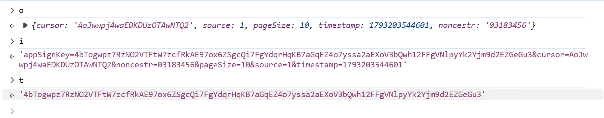
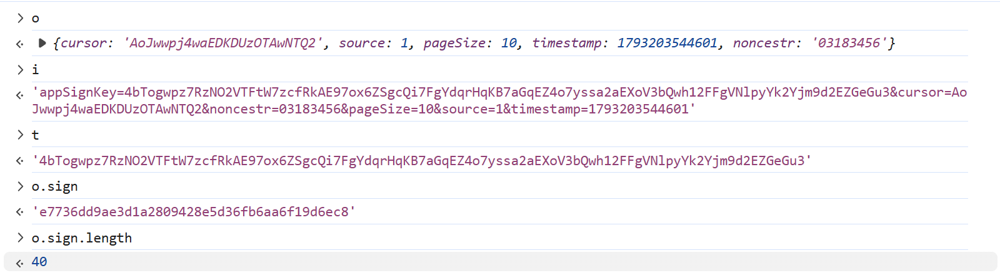
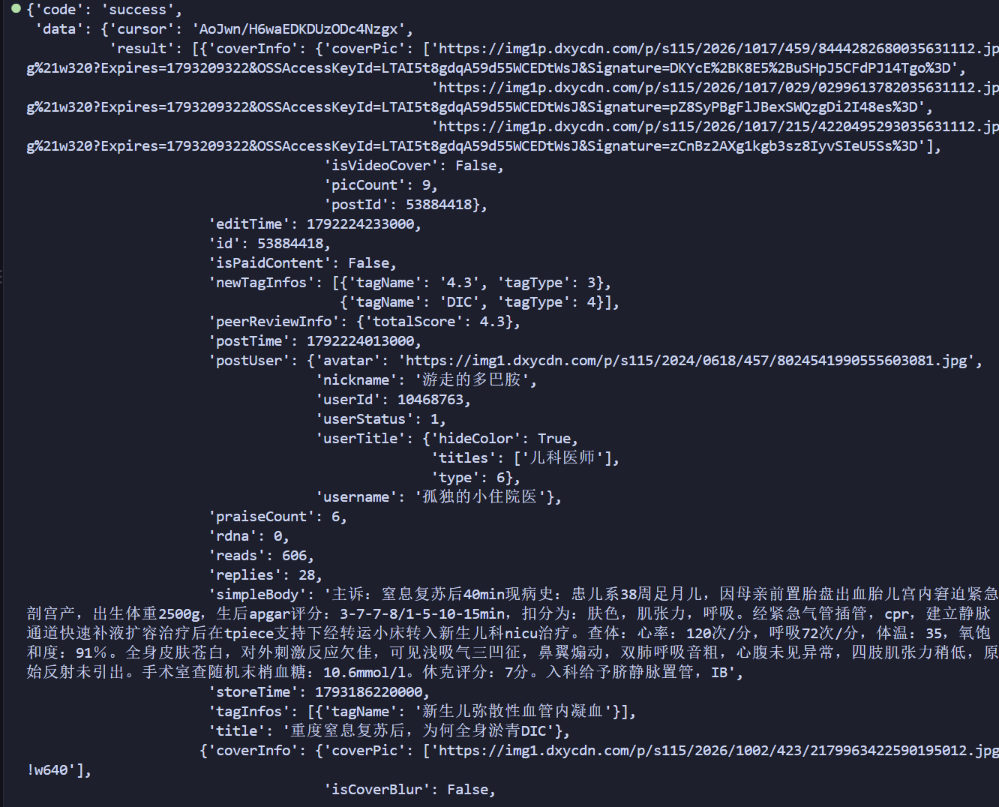
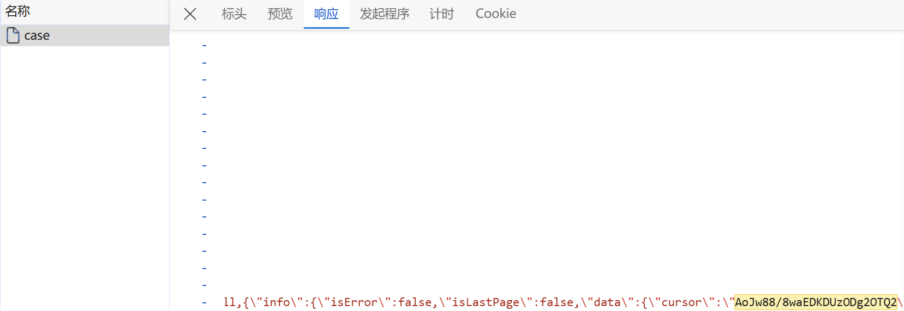

---
title: "JS逆向——丁香园sign——简单"
author: "Noah"
pubDatetime: 2026-10-26T00:00:00+08:00
description: "JS逆向、Web端"
tags:
  - JS逆向
  - 简单
featured: false
draft: false
---
网址：aHR0cHM6Ly93d3cuZHh5LmNuL2Jicy9uZXd3ZWIvcGMvaG9tZQ==
接口：aHR0cHM6Ly9iYnNhcGkuZHh5LmNuL3BjL2Nhc2UtYmFuay9wb3N0L3BhZ2U=
键盘F12打开Dev tools控制台，然后抓包，很明显就可以看到我们要逆向的接口

直接全局搜索sign，我们发现要找到太多了，所以我们可以试着搜索一下nonce，果然成功定位到了加密位置
```
var a = function() {
    let e = arguments.length > 0 && void 0 !== arguments[0] ? arguments[0] : {}
      , t = arguments.length > 1 && void 0 !== arguments[1] ? arguments[1] : "4bTogwpz7RzNO2VTFtW7zcfRkAE97ox6ZSgcQi7FgYdqrHqKB7aGqEZ4o7yssa2aEXoV3bQwh12FFgVNlpyYk2Yjm9d2EZGeGu3"
      , n = arguments.length > 2 && void 0 !== arguments[2] && arguments[2]
      , o = {
        ...e
    }
      , a = {
        appSignKey: t
    }
      , c = Date.now();
    o.timestamp = c + (window.__INITIAL_TIMESTAMP_DIFF__ || 0),
    o.noncestr = r(8, "number");
    let i = Object.keys(o).filter(e => void 0 !== o[e] && "" !== o[e] || (delete o[e],
    !1)).concat("appSignKey").sort().map(e => {
        let t = a[e] || (void 0 === o[e] ? "" : o[e]);
        return "".concat(e, "=").concat(t)
    }
    ).join("&");
    return n && console.log("sign", e, i),
    o.sign = s()(i),
    o
}
```
timestamp的话非常简单,标准的13位毫秒级时间戳
```
timestamp = f'{int(time.time())}'
```
至于nonce，其实就是**noncestr = r(8, "number");**
r函数如下所示：
```
let r = function() {
    let e = arguments.length > 0 && void 0 !== arguments[0] ? arguments[0] : 8
      , t = arguments.length > 1 && void 0 !== arguments[1] ? arguments[1] : "alphabet"
      , n = ""
      , o = {
        alphabet: "ABCDEFGHIJKLMNOPQRSTUVWXYZabcdefghijklmnopqrstuvwxyz",
        number: "0123456789"
    }[t];
    for (let t = 0; t < e; t++)
        n += o.charAt(Math.floor(Math.random() * o.length));
    return n
};
```
这个其实就是一个随机数生成器
```
import random

def random_str(length=8, charset_type="alphabet"):
    charset = {
        "alphabet": "ABCDEFGHIJKLMNOPQRSTUVWXYZabcdefghijklmnopqrstuvwxyz",
        "number": "0123456789",
    }[charset_type]
    return "".join(random.choice(charset) for _ in range(length))
```
接下来看i

这里其实很明显,就是把负载参数之间用&连接,然后再把app_sign_key拼接上
app_sign_key是个定值
代码如下所示:
```
app_sign_key = '4bTogwpz7RzNO2VTFtW7zcfRkAE97ox6ZSgcQi7FgYdqrHqKB7aGqEZ4o7yssa2aEXoV3bQwh12FFgVNlpyYk2Yjm9d2EZGeGu3'
s = "&".join(f"{k}={params[k]}" for k in sorted(params))
s = f"appSignKey={app_sign_key}&{s}"
```
看一下sign值是多少

40位的sign值,很明显是sha1啊.
我们这里可以测试一下
```
s = 'appSignKey=4bTogwpz7RzNO2VTFtW7zcfRkAE97ox6ZSgcQi7FgYdqrHqKB7aGqEZ4o7yssa2aEXoV3bQwh12FFgVNlpyYk2Yjm9d2EZGeGu3&cursor=AoJwwpj4waEDKDUzOTAwNTQ2&noncestr=03183456&pageSize=10&source=1&timestamp=1793203544601'
sign = hashlib.sha1(s.encode('utf-8')).hexdigest()
print(sign)
```
结果是终端输出:**e7736dd9ae3d1a2809428e5d36fb6aa6f19d6ec8**
结果和o.sign完全一致.
到这里基本的逆向我们已经做完了,可以写代码测试一下.
```
import time
import requests
from pprint import pprint
import random
import hashlib

headers = {
    'accept': '*/*',
    'accept-language': 'zh-CN,zh;q=0.9,en;q=0.8',
    'cache-control': 'no-cache',
    'origin': 'https://www.dxy.cn',
    'pragma': 'no-cache',
    'priority': 'u=1, i',
    'referer': 'https://www.dxy.cn/',
    'sec-ch-ua': '"Not:A-Brand";v="8", "Chromium";v="156", "Microsoft Edge";v="156"',
    'sec-ch-ua-mobile': '?0',
    'sec-ch-ua-platform': '"Windows"',
    'sec-fetch-dest': 'empty',
    'sec-fetch-mode': 'cors',
    'sec-fetch-site': 'same-site',
    'user-agent': 'Mozilla/5.0 (Windows NT 10.0; Win64; x64) AppleWebKit/537.36 (KHTML, like Gecko) Chrome/156.0.0.0 Safari/537.36 Edg/156.0.0.0',
    'cookie': 'JUTE_SESSION_ID=6599ae4d-31ee-49d7-853d-289f5b3ea9a3',
}

def random_str(length=8, charset_type="number"):
    charset = {
        "alphabet": "ABCDEFGHIJKLMNOPQRSTUVWXYZabcdefghijklmnopqrstuvwxyz",
        "number": "0123456789",
    }[charset_type]
    return "".join(random.choice(charset) for _ in range(length))

params = {
    'cursor': 'AoJw88/8waEDKDUzODg2OTQ2',
    'source': '1',
    'pageSize': '10',
    'timestamp': f'{int(time.time() * 1000)}',
    'noncestr': random_str(),
    # 'sign': '0a1ba8f42c9e45d121ab674b725453c01991bc78',
}
app_sign_key = "4bTogwpz7RzNO2VTFtW7zcfRkAE97ox6ZSgcQi7FgYdqrHqKB7aGqEZ4o7yssa2aEXoV3bQwh12FFgVNlpyYk2Yjm9d2EZGeGu3"
s = "&".join(f"{k}={params[k]}" for k in sorted(params))
s = f"appSignKey={app_sign_key}&{s}"
sign = hashlib.sha1(s.encode('utf-8')).hexdigest()
params['sign'] = sign

response = requests.get('https://bbsapi.dxy.cn/pc/case-bank/post/page', params=params, headers=headers)
pprint(response.json())
```
终端输出:

现在我们是可以拿到当前游标分页的数据了.
但是如果想批量采集的话,还需要直到当前游标和下一页游标是怎么来的.
下一页游标其实就是**response.json()['data']['cursor']**
那当前游标呢?
全局搜索一下**AoJw88/8waEDKDUzODg2OTQ2**,发现它是镶嵌在当前文档页面里的一段json里的

可以写一个正则提取出来.
这里就不再赘述了.
这样的话分页采集的点也解决了.
本篇完结.