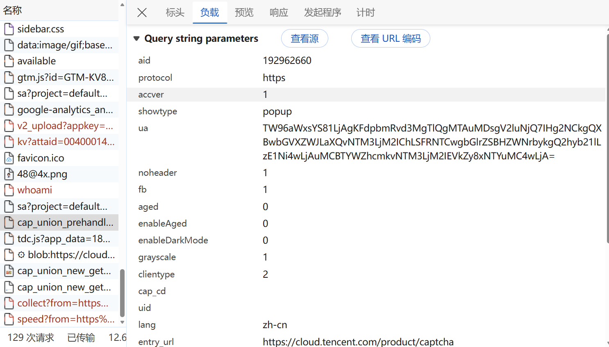

---
title: "JS逆向仓库004:某Q验证码JSVMP纯算逆向(困难) [待完成]"
author: "Zsx"
pubDatetime: 2026-10-26T00:00:00+08:00
description: "JSVMP逆向"
tags:
  - JS逆向
  - WEB端
  - JSVMP
  - 滑块验证码
  - 点选验证码
featured: false
draft: false
---
# 1. 接口链路分析

网址:aHR0cHM6Ly9jbG91ZC50ZW5jZW50LmNvbS9wcm9kdWN0L2NhcHRjaGE=

一共三个接口:

- https://turing.captcha.qcloud.com/cap_union_prehandle
- https://turing.captcha.qcloud.com/cap_union_new_verify
- https://turing.captcha.qcloud.com/cap_union_new_getsig

```
先请求 prehandle接口
生成collect参数
if collect is √:
  return
else:
  请求 new_getsig接口
```

其实只需要看prehandle接口和verify接口就可以了,getsig其实和prehanlde差不多.

## 1.1 prehandle接口分析

接口：https://turing.captcha.qcloud.com/cap_union_prehandle

键盘f12打开devtools，抓包分析一下



看一下params：

```
params = {
    'aid': '192962660',
    'protocol': 'https',
    'accver': '1',
    'showtype': 'popup',
    'ua': 'TW96aWxsYS81LjAgKFdpbmRvd3MgTlQgMTAuMDsgV2luNjQ7IHg2NCkgQXBwbGVXZWJLaXQvNTM3LjM2IChLSFRNTCwgbGlrZSBHZWNrbykgQ2hyb21lLzE1Ni4wLjAuMCBTYWZhcmkvNTM3LjM2IEVkZy8xNTYuMC4wLjA=',
    'noheader': '1',
    'fb': '1',
    'aged': '0',
    'enableAged': '0',
    'enableDarkMode': '0',
    'grayscale': '1',
    'clientype': '2',
    'cap_cd': '',
    'uid': '',
    'lang': 'zh-cn',
    'entry_url': 'https://cloud.tencent.com/product/captcha',
    'elder_captcha': '0',
    'js': '/tgJCap.2f0b2c65.js',
    'login_appid': '',
    'wb': '2',
    'tkid': '1056529123',
    'subsid': '1',
    'callback': '_aq_778284',
    'sess': '',
}
```

测试了一下发现params全部都可以固定住。

aid和tk_id每一个网站都不同，应该类似于网站id。

第一个接口没有什么加密，直接request这个接口就好。

代码如下所示：

```
import requests
import re
import random
import json
from pprint import pprint

headers = {
    'Accept': '*/*',
    'Accept-Language': 'zh-CN,zh;q=0.9,en;q=0.8',
    'Connection': 'keep-alive',
    'Referer': 'https://cloud.tencent.com/',
    'Sec-Fetch-Dest': 'script',
    'Sec-Fetch-Mode': 'no-cors',
    'Sec-Fetch-Site': 'cross-site',
    'Sec-Fetch-Storage-Access': 'active',
    'User-Agent': 'Mozilla/5.0 (Windows NT 10.0; Win64; x64) AppleWebKit/537.36 (KHTML, like Gecko) Chrome/156.0.0.0 Safari/537.36 Edg/156.0.0.0',
    'sec-ch-ua': '"Not:A-Brand";v="8", "Chromium";v="156", "Microsoft Edge";v="156"',
    'sec-ch-ua-mobile': '?0',
    'sec-ch-ua-platform': '"Windows"',
}

callback = f'_aq_{random.randint(000000, 999999)}'
params = {
    'aid': '192962660',
    'protocol': 'https',
    'accver': '1',
    'showtype': 'popup',
    'ua': 'TW96aWxsYS81LjAgKFdpbmRvd3MgTlQgMTAuMDsgV2luNjQ7IHg2NCkgQXBwbGVXZWJLaXQvNTM3LjM2IChLSFRNTCwgbGlrZSBHZWNrbykgQ2hyb21lLzE1Ni4wLjAuMCBTYWZhcmkvNTM3LjM2IEVkZy8xNTYuMC4wLjA=',
    'noheader': '1',
    'fb': '1',
    'aged': '0',
    'enableAged': '0',
    'enableDarkMode': '0',
    'grayscale': '1',
    'clientype': '2',
    'cap_cd': '',
    'uid': '',
    'lang': 'zh-cn',
    'entry_url': 'https://cloud.tencent.com/product/captcha',
    'elder_captcha': '0',
    'js': '/tgJCap.2f0b2c65.js',
    'login_appid': '',
    'wb': '2',
    'tkid': '1056529123',
    'subsid': '1',
    'callback': callback,
    'sess': '',
}

response = requests.get('https://turing.captcha.qcloud.com/cap_union_prehandle', params=params, headers=headers)
pattern = rf"{callback}\((.*?)\)"
match = re.search(pattern, response.text, re.S)
if match:
    json_str = match.group(1)
    json_dict = json.loads(json_str)
    pprint(json_dict)
```

这里简单使用正则来处理一下callback的问题。

直接终端运行代码，看一下输出：

```
{'capclass': '1',
 'data': {'comm_captcha_cfg': {'feedback_url': 'https://support.qq.com/products/304457',
                               'pow_cfg': {'md5': '3f1b1038b5180847699279e442e4219e',
                                           'prefix': '8f2e42948f739ad5#'},
                               'tdc_path': '/tdc.js?app_data=1824106341159940096&t=928630252'},
          'dyn_show_info': {'bg_elem_cfg': {'img_url': '/cap_union_new_getcapbysig?img_index=1&image=026109000000004400000015a292b614278e&sess=s0KJfWrDRXXNCVAHOyzVH0H_qYSQiMNa6Nx7KjoGkPz7ap3h7tyVdYmWNdzLN7tJdn5E27QsCZzvh63CJeACsIFz8au5-jZayK3vuOlpWlXUNO0jZYmlkaUPQh295WzDwBwdVp870CFA_T0-bvpg7yEKPAOVGc6lKIRI1YKdsOWLmAMhmZShgm1XDLcstq-yL1Iy_ozDC5f49THsiOuuK0JtTqOM0gEaQExEmfnHBCkIzyzqRYaa0D9zlXqzu3TvKctMaiAqX08j73_LXIZ-DPx2GlYpUTj8sPoXDn81dEoufb59lcz_djq4UG71BaQc6mESIDJvIRL2x9NHCQXh18DmDvopiIxJ-FeBs48_D-k_NCeQP7nxXFpZ3mA6SumdgrueliC-vewzUi2JZWvNc0_PxHaWFnZmTamiJ3GMx-LyAPRMz38h5Fbg**',
                                            'size_2d': [672, 480],
                                            'sprite_pos': [0, 0]},
                            'color_scheme': '#0057d4',
                            'fg_binding_list': [{'bind_factor': 1,
                                                 'bind_type': 'DynBindType_DX_DX',
                                                 'master': 1,
                                                 'slave': 2},
                                                {'bind_factor': 1,
                                                 'bind_type': 'DynBindType_DX_DX',
                                                 'master': 2,
                                                 'slave': 1}],
                            'fg_elem_list': [{'id': 3,
                                              'init_pos': [0, 422],
                                              'size_2d': [672, 32],
                                              'sprite_pos': [0, 422]},
                                             {'id': 1,
                                              'init_pos': [50, 192],
                                              'move_cfg': {'data_type': ['DynAnswerType_POS'],
                                                           'move_factor': [1,
                                                                           0],
                                                           'track_limit': 'x>=50&&x<=552'},
                                              'size_2d': [120, 120],
                                              'sprite_pos': [140, 490]},
                                             {'id': 2,
                                              'init_pos': [45, 402],
                                              'move_cfg': {'move_factor': [1,
                                                                           0],
                                                           'track_limit': 'x>=50&&x<=552'},
                                              'size_2d': [130, 70],
                                              'sprite_pos': [0, 490],
                                              'type': 'slider'}],
                            'instruction': '拖动下方滑块完成拼图',
                            'lang': 'zh-cn',
                            'sprite_url': '/cap_union_new_getcapbysig?img_index=0&image=026109000000004400000015a292b614278e&sess=s0KJfWrDRXXNCVAHOyzVH0H_qYSQiMNa6Nx7KjoGkPz7ap3h7tyVdYmWNdzLN7tJdn5E27QsCZzvh63CJeACsIFz8au5-jZayK3vuOlpWlXUNO0jZYmlkaUPQh295WzDwBwdVp870CFA_T0-bvpg7yEKPAOVGc6lKIRI1YKdsOWLmAMhmZShgm1XDLcstq-yL1Iy_ozDC5f49THsiOuuK0JtTqOM0gEaQExEmfnHBCkIzyzqRYaa0D9zlXqzu3TvKctMaiAqX08j73_LXIZ-DPx2GlYpUTj8sPoXDn81dEoufb59lcz_djq4UG71BaQc6mESIDJvIRL2x9NHCQXh18DmDvopiIxJ-FeBs48_D-k_NCeQP7nxXFpZ3mA6SumdgrueliC-vewzUi2JZWvNc0_PxHaWFnZmTamiJ3GMx-LyAPRMz38h5Fbg**'}},
 'log_js': '',
 'randstr': '',
 'sess': 's0kGjncIH9tqjN-Vb4oubiVdqbWwGPj9RVyiNxW6469iWyLElRvXJobJjx01IyiNL0fRK2L5C3emXesnTDkKu6zF41rbjRizDWNPy0y3lMd_zqub8GSg8UzDPWEAD43KSSSNR3JtfGyXc3zke0a0h7g1kiaRvduOilVSmYDwrdbOlNecWipbOJCXDz0GZjJaOBnfdDZuRdzr485K8rt2tItpWp0mD3rbtSiRN1btiOuy6qNSZX821kZghnnUSUElQLY_6Tnny5PqOu0QL7QyilDCIkQXN-lBzSerfP4eyyriAZ3igB5E4ev54uAceMs9gU_Bn_9DdfYlFO0uFND6-oTNEiEwe0CR_oUz1-S693j9ghTigX-M5H-Lh42sjDlOvZlRpbZnf36qw5n10D6vczDSHJW_MPf3KlJ55E6TL7zfgem5KzswlAqA**',
 'sid': '1824106341159940096',
 'src_1': 'cap_union_new_show',
 'src_2': 'template/new_placeholder.html',
 'src_3': 'template/new_slide_placeholder.html',
 'state': 1,
 'subcapclass': '2401',
 'ticket': '',
 'uip': '117.136.120.113'}
```

这个输出其实很明显了，该给的参数都给了。

比如背景图url，滑块图url，pow工作量证明，sess，tdc的url，ans等等。

按个提取出来就好。

```
import requests
import re
import random
import json
from pprint import pprint
from pathlib import Path

class TencentCaptchaCrack():
    session = requests.Session()
    session.headers = {
        'Accept': '*/*',
        'Accept-Language': 'zh-CN,zh;q=0.9,en;q=0.8',
        'Connection': 'keep-alive',
        'Referer': 'https://cloud.tencent.com/',
        'Sec-Fetch-Dest': 'script',
        'Sec-Fetch-Mode': 'no-cors',
        'Sec-Fetch-Site': 'cross-site',
        'Sec-Fetch-Storage-Access': 'active',
        'User-Agent': 'Mozilla/5.0 (Windows NT 10.0; Win64; x64) AppleWebKit/537.36 (KHTML, like Gecko) Chrome/156.0.0.0 Safari/537.36 Edg/156.0.0.0',
        'sec-ch-ua': '"Not:A-Brand";v="8", "Chromium";v="156", "Microsoft Edge";v="156"',
        'sec-ch-ua-mobile': '?0',
        'sec-ch-ua-platform': '"Windows"',
    }
    <!-- session.proxies = {
        "http": "http://127.0.0.1:7890",
        "https": "http://127.0.0.1:7890",
    } -->

    def __init__(self, aid: str = '192962660', tkid: str = '1056529123'):
        self.aid = aid
        self.tkid = tkid
        self.static_url = 'https://turing.captcha.qcloud.com'

    def run(self):
        callback = f'_aq_{random.randint(000000, 999999)}'
        params = {
            'aid': self.aid,
            'protocol': 'https',
            'accver': '1',
            'showtype': 'popup',
            'ua': 'TW96aWxsYS81LjAgKFdpbmRvd3MgTlQgMTAuMDsgV2luNjQ7IHg2NCkgQXBwbGVXZWJLaXQvNTM3LjM2IChLSFRNTCwgbGlrZSBHZWNrbykgQ2hyb21lLzE1Ni4wLjAuMCBTYWZhcmkvNTM3LjM2IEVkZy8xNTYuMC4wLjA=',
            'noheader': '1',
            'fb': '1',
            'aged': '0',
            'enableAged': '0',
            'enableDarkMode': '0',
            'grayscale': '1',
            'clientype': '2',
            'cap_cd': '',
            'uid': '',
            'lang': 'zh-cn',
            'entry_url': 'https://cloud.tencent.com/product/captcha',
            'elder_captcha': '0',
            'js': '/tgJCap.2f0b2c65.js',
            'login_appid': '',
            'wb': '2',
            'tkid': self.tkid,
            'subsid': '1',
            'callback': callback,
            'sess': '',
        }

        response = self.session.get('https://turing.captcha.qcloud.com/cap_union_prehandle', params=params)
        pattern = rf"{callback}\((.*?)\)"
        match = re.search(pattern, response.text, re.S)
        if match:
            json_str = match.group(1)
            json_dict = json.loads(json_str)
            pprint(json_dict)
            md5 = json_dict['data']['comm_captcha_cfg']['pow_cfg']['md5']
            prefix = json_dict['data']['comm_captcha_cfg']['pow_cfg']['prefix']
            bg_url = self.static_url + json_dict['data']['dyn_show_info']['bg_elem_cfg']['img_url']
            bg_path = Path(__file__).parent.resolve().joinpath('bg.png')
            bg_bytes = self.session.get(bg_url).content
            bg_path.write_bytes(bg_bytes)
            slide_url = self.static_url + json_dict['data']['dyn_show_info']['sprite_url']
            slide_path = Path(__file__).parent.resolve().joinpath('slide.png')
            slide_bytes = self.session.get(slide_url).content
            slide_path.write_bytes(slide_bytes)
            y = json_dict['data']['dyn_show_info']['fg_elem_list'][1]['init_pos'][0]
            sess = json_dict['sess']
```

这个接口的话主要就是获取一些参数，还有验证码图片，简单处理即可。

然后我们可以看下第二个接口。

## 1.2 verify接口分析

接口：https://turing.captcha.qcloud.com/cap_union_new_verify

这个接口就是校验接口了，需要校验collect参数。

看一下负载参数吧。

```
data = {
    'collect': '1HiFPLuqzBEooqb55X2T7RyWN2cYw9svGZDoVJjSiW3uTDKsK3c1XmFwSDzdvwLTrPGyX%2FAo8%2F8PuZVwwfT%2BhEjNrEdqvhGnBzPMsd0ty6K9Fl8cHJ%2BMYnrXlxGcL6ui68P0QGPuU0XaxIBdWke7CGAUL6mrj9cC2bFGjpz929FUfybf1ZLYc7P7MRA6x2FehmeR9%2F3%2FrAS2EUmJE%2F0XIN8uLGuaw9YjIVWPhuV%2BJfcGAgGEHsvDfKSIjiGkYs0Jujy7ITkq57soqMJHP4RuIiHsp217abKOnPxWivsv5SSrcy1LsKZrnX6a32dJMsNTVWWNSnJ0GdjKkTC2dZzDmAxFbnnN6HJcm2YYRgRCWWJ%2FxVz9xonFewWYxWN9VGS0%2FlnoeLfNvnBzuYcI0b1tp8%2Be760Yn17VbmRYj%2BZGi0z2n0%2FfN9uByihXpb9Bg1L3taPWb7afrL%2Fp27w4z4Accl6Vuj088QdcQ4fbH7HT6N5NeJpGwtN2Vp0Qbg8mI1ohcFaEuERE7M4OF22Q0K%2Fev9%2FT9k%2BKTCT9bd9KxEZHepBVWA%2FqbBtd6DELAjl4vePimip5X6WNk%2BieA3LYfBURj%2FZIzmC1AERKa7a6Qn%2F9YZs8tWSoJFM9uxTgbkdnV2%2Ff7%2BI%2Fl7qnwaTDXcGTMiOb9oOzoa59gPg3zPfvd8%2FMhJzA1d6%2Fe6miO8lzVrHXNWSzc5gdxTvD4EGoLi06upPSx6guLTq6k9LHKJidZrvymNo26mRTt9xlnQnV8Xs85ZZx8q8v6wK6a1rHJknKE9GHRWZY%2Bhz7q2DaaE%2F3eV240GB6W2Jd0pusQAdigx5q7Ra3RdK0vyTunBmdi%2BGoud%2FRJ8MUCnVjbjzkzXFNQbOISmYW61DS6eanunj2PslYllAfFn1b0eehjh0vvsUFwfTq6SLQgOvq5K8EaNEL48drQQ%2FvpIQ2RTJFbyHohqCjFYjPoYcCgSPy6Dej%2BHVB0KRKQ4sznH8bOKBZxTUiunk9qp%2BVVjncJAitGaQoLROZmk9Nm%2FYOyptE5%2FKyuf80m4UuKSJo8NiGkJBUqhK%2FBUYKgiV0yUytqKzyuaNc4HHQ4V%2BUg73oQZt4O8SzgsOTqbY9TxLDsgrxWrz3ZfKps%2B%2B7%2BfhTgT8%2FlsA%2BTAP0ZXmyv1FHeMExWWERcaNl8qmz77v5%2BMM1c%2Bh%2FruD3084YW6g1%2BqbQHWB7UpiWQnl8%2F%2F1bHo2ksvylZ%2FlgxnJ%2FY4R7miTQqPpwNpVLMGZPzt2i%2F1d6B3uM%2BF5cTBFKTyXy7UMhRuRmu5iOepCE6iAHYoMeau0WtzbGQ5h4cgy5MQPPrbXZAm9L7dvqldJr7WxrNtshplu5jR7%2Fo7zPzAJiSSh%2BuNnzq0wh1iV0X6ce0n9%2FUCNfsL3AfSZgYx4B%2Fadyr5HzTk0YNEpvE3y8m%2FOD2%2FvVCeXYGXqRRT%2FkVJDMB2KDHmrtFregSBAfOL6s%2BMC2ZJh82O2szt2i%2F1d6B3tHVHt1KtKoUY88e2DkLEiIUvpu8M6DxRQqDmvzBUJpzKguLTq6k9LHEm2GuLYnJCh2IYHtPXZkoVcfl70JJtdoiYAsh7VPuY6RARFZSh1ActE9NwfpwUjPrRcDHOhz%2FrpZWzHLfzE3pjhxDHA9RzmdbwG%2BPwe8y65PjIHu6wZuUT9%2BfBhAi0rfUKgEj8ogUezGubl1GE88eMNNpcXj5UYESckgUO4AZlIKYhVaNCmVh2v%2BdzkLpOLgAf%2B%2BE41tV8FuTy7%2FBa9ZAQ%3D%3D',
    'tlg': '1752',
    'eks': 'kxdPZM7NEqrkPmMCnT%2FBjWNuW%2FW3Hh%2BxSh6Ms%2FPcZJr0MUAfuEPbNjoDERy44lsj8M4fWbERxkIaJnMbQO0nSq%2FYg6wivMWtaVFnjVU9OG64GaEKurISg8lmgVceluZ8IrPoEmVmvPBancRgFYzpPb0n0qzqoLEkgvJNCYwouK3RXA36msYerbgpUPNlHx3A5vfmdlcAAFf196ZRkqmz6TXD%2BqBIRc9PieQIYR%2B3%2Bz9QJy5GqZdofw%3D%3D',
    'sess': 's0phgtWbesDu0cjMcyg0mAPHNBCJVHSLJj2-BVuUdy2-vxU9mW46YycmG4QbHWYN7bTWxchkeP-xx9CCB5_khp45RqdRcEOTqPy6h2I1tOWfvHy5gwMoswFjO7VnaAGgZC3mjgckTHoAr9z2-WI0A5dvVY8TaL2zMUVknJq1JDfQfP6MxnCNIiB9i0dKY5lrII7-uP1JzoWPwYyx4d3m6xj_4rA8lvg2OzON-XozdScJexBwK6PLl9-09CQWVlqAIm_NRRoGtYnWNyR_6XklrN35nah02PO9kf_Jby389zkKzD9twofsDzylXBwWZAdJD3R7QF5df9D8EBvBuB3_czJBY0y5GpW2bZFmb0oIOSuxuIJD6tfZxkmC96Lt_No22tFO1sbXOV0AbdGReJvjCUkwRo7ubcx_UZjCzKHsNs-HKPdQUsilDVh4EZ4gio-jS1LgEZrf-hd05Stg_vZPdTBj4ZasBZ721pW5mzZK9WIJMjE5C8DlwtsA**',
    'ans': '%5B%7B%22elem_id%22%3A1%2C%22type%22%3A%22DynAnswerType_POS%22%2C%22data%22%3A%22204%2C138%22%7D%5D',
    'tkid': '1056529123',
    'pow_answer': '4ebea6095214329d%235804',
    'pow_calc_time': '18'
}
```

分析一下这几个参数：

- collect：**本次需要逆向的加密参数**
- eks：**硬编码在TDC JSVMP中**
- ans：**只需要解决x，x就是滑块移动距离**
- pow_answer：**工作量证明，由前面prehandle接口的md5和prefix算出**
- pow_calc_time：**计算出pow_answer所需要的时间**

大致链路解决了，接下来我们就挨个分析吧。

# 2. 简单的几个参数逆向

# 3. JSVMP分析

## 3.1 jsdom补环境

这里来到了重头戏，我们要开始分析JSVMP了。

collect是由JSVMP计算得出的，我们可以直接在devtools里搜索这个参数，可以定位到它的位置。

```
_0x1fdcdc = _0x1a27e1 > -0x1 && _0x1a27e1 <= 0x8 ? decodeURIComponent(_0x564a8c(0x2e9)) : decodeURIComponent((0x0,
_0xd45089[_0x564a8c(0x107)])());
var _0x4f1027 = (0x0,
_0xd45089[_0x564a8c(0x505)])()
    , _0x3e71e5 = {
    'collect': _0x1fdcdc,
    'tlg': _0x1fdcdc[_0x564a8c(0x203)],
    'eks': _0x4f1027,
    'sess': this[_0x564a8c(0x88a)],
    'ans': JSON[_0x564a8c(0x3d2)](_0x59080e)
}
```

collect是由_0x1fdcdc赋值的，我们往上找_0x1fdcdc，可以看到_0x1fdcdc又是由decodeURIComponent((0x0,
_0xd45089[_0x564a8c(0x107)])())得到的。里面是一个逗号表达式。

我们可以查看这个方法**_0xd45089[_0x564a8c(0x107)]**直接找到JSVMP的入口方法处。

```
_0x441088['getTdcData'] = function() {
    var _0x305124 = _0x4912d1;
    return _0x213914({
        'ft': (0x0,
        _0x5a6fa6[_0x305124(0x9ba)])()
    }),
    window['TDC'] && _0x305124(0x1bc) == typeof window['TDC'][_0x305124(0x7b0)] ? window[_0x305124(0x215)]['getData'](!0x0) || _0x305124(0x2e9) : '------';
}
```
这个**window[_0x305124(0x215)]['getData']**其实就是**window.TDC.getData()**方法。

这里的**window.TDC.getData()**方法就是返回的collect的值。

点击这个方法**window.TDC.getData()**，跳转进去是一个js文件，这个js文件就是我们的**TDC JSVMP**了。

eks是由_0x4f1027赋值的，路数和collect一样，最后可以找到一个**window.TDC.getInfo()**的方法，用来返回eks的值的。
JSVMP代码如下所示。

```
window._cWcPJEXBJPWSEJYiakMSnZYfWlTfgdSS = function() {
    return new Date()
}
;
window._aefhRRNlYEWedEiQPelhSFDCMPhdSjhN = function(a, b) {
    return Date[a].apply(Date, b)
}
;
window.ReWXYXPcDDikEhiFaXdBlGfhEQXPiZTg = '36jaVu0hbD9fPxDwJpjZbqq+4ddL0PAQI5blZhW758qwsXI52BI37ccOsoNALtgZ/mDsftuzvqdivhjidvJhVCE5LC8RTZcIzIGlUUUIjBoNc3BfWzW3AZutq4Tfuv1m4OnIzN9CmzYBHOdUijCpTE4rYTUaeAdPnIjfBGt+gfOG6cWOvpFwaiVVgjNSUVz5hpZAQMFlWEIC0k2tlqWZUEvfjphmZ6CA2SnEUfKR0tVvV6RchmhM1w==';
var __TENCENT_CHAOS_STACK = function() {
    function __TENCENT_CHAOS_VM(w, R, D, I, M, E, g, X) {
        var Q, V = !I, F = (w = +w,
        R = R || [0],
        I = I || [[this], [{}]],
        M = M || {},
        []), B = null;
        function A() {
            return function(V, F, B) {
                return new (Function.bind.apply(V, F))
            }
            .apply(null, arguments)
        }
        Function.prototype.bind || (Q = [].slice,
        Function.prototype.bind = function(V) {
            if ("function" != typeof this)
                throw new TypeError("bind101");
            var F = Q.call(arguments, 1)
              , B = F.length
              , A = this
              , W = function() {}
              , U = function() {
                return F.length = B,
                F.push.apply(F, arguments),
                A.apply(W.prototype.isPrototypeOf(this) ? this : V, F)
            };
            return this.prototype && (W.prototype = this.prototype),
            U.prototype = new W,
            U
        }
        );
        for (var W = [function() {
            I.push(null)
        }
        , function() {
            var V = R[w++]
              , F = I[I.length - 2 - V];
            I[I.length - 2 - V] = I.pop(),
            I.push(F)
        }
        , , function() {
            I[I.length - 2] = I[I.length - 2] ^ I.pop()
        }
        , function() {
            var V = I[I.length - 2];
            V[0][V[1]] = I[I.length - 1]
        }
        , function() {
            I[I.length - 2] = I[I.length - 2] >>> I.pop()
        }
        , , function() {
            I.push(!0)
        }
        , function() {
            var V = R[w++];
            I[I.length - 1] && (w = V)
        }
        , function() {
            I[I.length - 2] = I[I.length - 2] >= I.pop()
        }
        , function() {
            for (var B = R[w++], A = [], V = R[w++], F = R[w++], W = [], U = 0; U < V; U++)
                A[R[w++]] = I[R[w++]];
            for (U = 0; U < F; U++)
                W[U] = R[w++];
            I.push(function Q() {
                var V = A.slice(0);
                V[0] = [this],
                V[1] = [arguments],
                V[2] = [Q];
                for (var F = 0; F < W.length && F < arguments.length; F++)
                    0 < W[F] && (V[W[F]] = [arguments[F]]);
                return __TENCENT_CHAOS_VM(B, R, D, V, M, E, g, X)
            })
        }
        , function() {
            I[I.length - 2] = I[I.length - 2] << I.pop()
        }
        , function() {
            var V, F = [];
            for (V in I.pop())
                F.push(V);
            I.push(F)
        }
        , function() {
            I[I.length - 2] = I[I.length - 2] >> I.pop()
        }
        , , function() {
            I[I.length - 1] = D[I[I.length - 1]]
        }
        , function() {
            I.push(undefined)
        }
        , function() {
            I[I.length - 2] = I[I.length - 2] in I.pop()
        }
        , function() {
            I[I.length - 2] = I[I.length - 2] === I.pop()
        }
        , function() {
            I.push([R[w++]])
        }
        , function() {
            I.length = R[w++]
        }
        , function() {
            I[I.length - 1] += String.fromCharCode(R[w++])
        }
        , , function() {
            F.push([R[w++], I.length, R[w++]])
        }
        , function() {
            I[I[I.length - 2][0]][0] = I[I.length - 1]
        }
        , function() {
            I[I.length - 2] = I[I.length - 2] % I.pop()
        }
        , function() {
            I[I.length - 2] = I[I.length - 2] & I.pop()
        }
        , function() {
            I[I.length - 2] = I[I.length - 2] | I.pop()
        }
        , function() {
            I.push(typeof I.pop())
        }
        , function() {
            I.push(!1)
        }
        , function() {
            B = null
        }
        , function() {
            F.pop()
        }
        , , , function() {
            var V = R[w++];
            I[V] = I[V] === undefined ? [] : I[V]
        }
        , function() {
            return !!B
        }
        , function() {
            I[I.length - 1] = R[w++]
        }
        , function() {
            I.push("")
        }
        , function() {
            I[I.length - 2] = I[I.length - 2] - I.pop()
        }
        , function() {
            I.push([D, I.pop()])
        }
        , function() {
            I[I.length - 1].length ? I.push(I[I.length - 1].shift(), !0) : I.push(undefined, !1)
        }
        , function() {
            var V = R[w++]
              , F = V ? I.slice(-V) : [];
            I.length -= V,
            F.unshift(null),
            I.push(A(I.pop(), F))
        }
        , function() {
            I.push(!I.pop())
        }
        , function() {
            I.push(I[I.length - 1])
        }
        , , function() {
            I.push(I[R[w++]][0])
        }
        , function() {
            I[I.length - 2] = I[I.length - 2] == I.pop()
        }
        , , function() {
            I.push([I.pop(), I.pop()].reverse())
        }
        , function() {
            throw I[I.length - 1]
        }
        , function() {
            var V = I.pop();
            I.push([I[I.pop()][0], V])
        }
        , function() {
            var V = R[w++]
              , F = V ? I.slice(-V) : [];
            I.length -= V,
            I.push(I.pop().apply(D, F))
        }
        , function() {
            w = R[w++]
        }
        , function() {
            I[I.length - 2] = I[I.length - 2] + I.pop()
        }
        , function() {
            var V = R[w++]
              , F = V ? I.slice(-V) : []
              , V = (I.length -= V,
            F.unshift(null),
            I.pop());
            I.push(A(V[0][V[1]], F))
        }
        , function() {
            var V = I.pop();
            I.push(V[0][V[1]])
        }
        , function() {
            var V = R[w++]
              , F = V ? I.slice(-V) : []
              , V = (I.length -= V,
            I.pop());
            I.push(V[0][V[1]].apply(V[0], F))
        }
        , function() {
            var V = I.pop()
              , F = I.pop();
            I.push([F[0][F[1]], V])
        }
        , function() {
            I[I.length - 2] = I[I.length - 2] * I.pop()
        }
        , function() {
            I.push(R[w++])
        }
        , function() {
            I.pop()
        }
        , function() {
            I[I.length - 2] = I[I.length - 2] > I.pop()
        }
        , , function() {
            I[I.length - 2] = I[I.length - 2] / I.pop()
        }
        , , function() {
            return !0
        }
        , , function() {
            var V = I.pop();
            I.push(delete V[0][V[1]])
        }
        , , function() {
            I.push(I[I.pop()[0]][0])
        }
        ]; ; )
            try {
                for (var U = !1; !U; )
                    U = W[R[w++]]();
                if (B)
                    throw B;
                return V ? (I.pop(),
                I.slice(3 + __TENCENT_CHAOS_VM.v)) : I.pop()
            } catch (c) {
                var h = F.pop();
                if (h === undefined)
                    throw c;
                B = c,
                w = h[0],
                I.length = h[1],
                h[2] && (I[h[2]][0] = B)
            }
    }
    function M(V) {
        for (var F, B, A = "ABCDEFGHIJKLMNOPQRSTUVWXYZabcdefghijklmnopqrstuvwxyz0123456789+/=".split(""), W = String(V).replace(/[=]+$/, ""), U = 0, Q = 0, w = ""; B = W.charAt(Q++); ~B && (F = U % 4 ? 64 * F + B : B,
        U++ % 4) && (w += String.fromCharCode(255 & F >> (-2 * U & 6))))
            B = function(V, F, B) {
                if ("function" == typeof Array.prototype.indexOf)
                    return Array.prototype.indexOf.call(V, F, B);
                var A;
                if (null == V)
                    throw new TypeError('"array" is null or not defined');
                var W = Object(V)
                  , U = W.length >>> 0;
                if (0 != U) {
                    V = 0 | B;
                    if (!(U <= V))
                        for (A = Math.max(0 <= V ? V : U - Math.abs(V), 0); A < U; A++)
                            if (A in W && W[A] === F)
                                return A
                }
                return -1
            }(A, B);
        return w
    }
    return __TENCENT_CHAOS_VM.v = 0,
    __TENCENT_CHAOS_VM(0, function(V) {
        var F = V[0]
          , B = V[1]
          , A = []
          , W = M(F)
          , U = B.shift()
          , Q = B.shift()
          , w = 0;
        function R() {
            for (; w === U; )
                A.push(Q),
                w++,
                U = B.shift(),
                Q = B.shift()
        }
        for (var D = 0; D < W.length; D++) {
            var I = W.charAt(D).charCodeAt(0);
            R(),
            A.push(I),
            w++
        }
        return R(),
        A
    }(["", [5, 1518, 303, 445, 329, 334, 332, 443, 446, 305, 464, 798, 509, 513, 511, 553, 554, 559, 557, 693, 799, 466, 813, 1233, 833, 838, 836, 850, 857, 862, 860, 866, 873, 877, 875, 895, 896, 900, 898, 903, 904, 908, 906, 934, 935, 940, 938, 944, 1122, 1126, 1124, 1145, 1146, 1151, 1149, 1229, 1157, 1163, 1161, 1225, 1182, 1197, 1198, 1184, 1223, 1155, 1227, 1229, 1234, 815, 1251, 1374, 1266, 1270, 1268, 1296, 1297, 1318, 1300, 1309, 1310, 1302, 1316, 1352, 1320, 1346, 1347, 1322, 1375, 1253, 1391, 1482, 1483, 1393, 1542, 2085, 1702, 1814, 1706, 2082, 1742, 1801, 1802, 1744, 1812, 2082, 1817, 1704, 1865, 1928, 1929, 1867, 2086, 1544, 2100, 2914, 2211, 2760, 2272, 2276, 2274, 2293, 2294, 2668, 2347, 1e9, 2400, 1e9, 2494, 2498, 2496, 2583, 2602, 1e3, 2666, 2758, 2736, 2741, 2739, 2758, 2750, 1e3, 2761, 2213, 2785, 2839, 2840, 2787, 2868, 2877, 2878, 2870, 2915, 2102, 2929, 4143, 2946, 3445, 2963, 2973, 2967, 3222, 2971, 3222, 2976, 2965, 3224, 3234, 3228, 3442, 3232, 3442, 3237, 3226, 3281, 3286, 3284, 3336, 3382, 3387, 3385, 3441, 3448, 2948, 3457, 4042, 3488, 3498, 3492, 3542, 3496, 3542, 3501, 3490, 3632, 3637, 3635, 3799, 3677, 3682, 3680, 3705, 3806, 3816, 3810, 4033, 3814, 4033, 3819, 3808, 3863, 3868, 3866, 3920, 3966, 3971, 3969, 4032, 3977, 4029, 4037, 4041, 4045, 3459, 4144, 2931, 4158, 6666, 4209, 4348, 4227, 4232, 4230, 4235, 4266, 4270, 4271, 4276, 4274, 4346, 4302, 4307, 4305, 4342, 4340, 4294, 4351, 4211, 4360, 4940, 4468, 4473, 4471, 4892, 4489, 4494, 4492, 4498, 4496, 4869, 4574, 4585, 4583, 4605, 4612, 4617, 4615, 4629, 4641, 4820, 4648, 4673, 4674, 4799, 4693, 4738, 4701, 4724, 4722, 4753, 4736, 4753, 4746, 4749, 4772, 4777, 4775, 4869, 4789, 4792, 4797, 4869, 4818, 4869, 4840, 4846, 4844, 4853, 4867, 4869, 4890, 4445, 4943, 4362, 4960, 5098, 4997, 5079, 5024, 5029, 5027, 5096, 5035, 5041, 5039, 5072, 5070, 5033, 5074, 5096, 5077, 5096, 5101, 4962, 5114, 5203, 5152, 5157, 5155, 5201, 5199, 5129, 5206, 5116, 5215, 5509, 5257, 5262, 5260, 5434, 5284, 5289, 5287, 5337, 5353, 5358, 5356, 5376, 5388, 5393, 5391, 5411, 5432, 5234, 5464, 5469, 5467, 5507, 5505, 5441, 5512, 5217, 5562, 5566, 5564, 5615, 5616, 5793, 5619, 5785, 5630, 5634, 5632, 5668, 5669, 5673, 5671, 5716, 5717, 5721, 5719, 5761, 5762, 5770, 5768, 5784, 5786, 5621, 5791, 5812, 5795, 5807, 5808, 5797, 6236, 6615, 6272, 6343, 6276, 6564, 6341, 6564, 6346, 6274, 6360, 6394, 6395, 6400, 6398, 6406, 6586, 6605, 6606, 6588, 6616, 6238, 6667, 4160, 6681, 7054, 6706, 6823, 6715, 6815, 6816, 6717, 6824, 6708, 7055, 6683, 7069, 7110, 7111, 7071, 7125, 10090, 7152, 7232, 7235, 7154, 7243, 7597, 7289, 84941944608, 7295, 7300, 7298, 7575, 7314, 7390, 7324, 7356, 7354, 7421, 7383, 197409, 7388, 7421, 7417, 197378, 7436, 2654435769, 7449, 7534, 7462, 7497, 7495, 7568, 7527, 197409, 7532, 7568, 7564, 197378, 7573, 7288, 7600, 7245, 7611, 7720, 7645, 7650, 7648, 7716, 7714, 7637, 7723, 7613, 7731, 9583, 7805, 7929, 7843, 7848, 7846, 7917, 7915, 7835, 7930, 7807, 7960, 8084, 7998, 8003, 8001, 8072, 8070, 7990, 8085, 7962, 8115, 8240, 8151, 8156, 8154, 8228, 8226, 8143, 8241, 8117, 8271, 8398, 8309, 8314, 8312, 8386, 8384, 8301, 8399, 8273, 8424, 8474, 8435, 8445, 8439, 8471, 8443, 8471, 8448, 8437, 8475, 8426, 8490, 8617, 8528, 8533, 8531, 8605, 8603, 8520, 8618, 8492, 8643, 8693, 8654, 8664, 8658, 8690, 8662, 8690, 8667, 8656, 8694, 8645, 8704, 8754, 8715, 8725, 8719, 8751, 8723, 8751, 8728, 8717, 8755, 8706, 8765, 8815, 8776, 8786, 8780, 8812, 8784, 8812, 8789, 8778, 8816, 8767, 8826, 8876, 8837, 8847, 8841, 8873, 8845, 8873, 8850, 8839, 8877, 8828, 8892, 9019, 8930, 8935, 8933, 9007, 9005, 8922, 9020, 8894, 9045, 9095, 9056, 9066, 9060, 9092, 9064, 9092, 9069, 9058, 9096, 9047, 9111, 9236, 9147, 9152, 9150, 9224, 9222, 9139, 9237, 9113, 9267, 9392, 9303, 9308, 9306, 9380, 9378, 9295, 9393, 9269, 9447, 9452, 9450, 9575, 9573, 9424, 9586, 7733, 9634, 10003, 9637, 9998, 9853, 9868, 9869, 9874, 9872, 9994, 9906, .75, 9921, 9926, 9924, 9935, 9992, 9829, 9999, 9639, 10063, 10078, 10079, 10065, 10091, 7127, 10105, 11236, 11237, 10107, 11251, 13271, 11290, 11781, 11307, 11336, 11346, 11351, 11349, 11779, 11392, 11438, 11436, 11482, 11593, 11597, 11595, 11682, 11784, 11292, 11802, 12193, 11873, 11878, 11876, 12134, 11896, 12032, 12030, 12104, 12132, 11850, 12196, 11804, 12302, 12308, 12306, 12311, 12426, 12430, 12428, 12515, 12578, 12811, 12620, 12731, 12708, 12750, 12729, 12750, 12812, 12580, 12834, 13192, 12899, 12904, 12902, 12992, 12990, 12876, 13076, 13081, 13079, 13147, 13107, 13112, 13110, 13147, 13145, 13099, 13193, 12836, 13219, 13255, 13256, 13221, 13272, 11253, 13286, 13472, 13301, 13435, 13367, 13388, 13386, 13433, 13438, 13303, 13473, 13288, 13487, 15523, 13508, 14005, 13560, 13564, 13562, 13598, 13599, 13604, 13602, 13962, 13706, 13710, 13708, 13745, 13746, 13799, 13797, 13948, 13805, 13851, 13849, 13871, 13879, 13925, 13923, 13945, 14008, 13510, 14018, 14557, 14084, 14088, 14086, 14136, 14137, 14142, 14140, 14514, 14258, 14262, 14260, 14297, 14298, 14351, 14349, 14500, 14357, 14403, 14401, 14423, 14431, 14477, 14475, 14497, 14560, 14020, 14570, 15353, 14678, 14682, 14680, 14717, 14718, 14771, 14769, 14920, 14777, 14823, 14821, 14843, 14851, 14897, 14895, 14917, 14936, 15247, 14939, 14963, 14943, 15243, 14961, 15243, 14966, 14941, 14973, 15095, 15061, 15125, 15093, 15125, 15245, 15310, 15253, 15260, 15258, 15276, 15284, 15291, 15289, 15307, 15356, 14572, 15524, 13489, 15538, 16129, 15555, 15766, 15566, 15578, 15570, 15763, 15576, 15763, 15581, 15568, 15676, 15680, 15678, 15750, 15705, 15716, 15714, 15736, 15751, 15756, 15754, 15760, 15769, 15557, 15813, 15817, 15815, 15866, 15867, 16044, 15870, 16036, 15881, 15885, 15883, 15919, 15920, 15924, 15922, 15967, 15968, 15972, 15970, 16012, 16013, 16021, 16019, 16035, 16037, 15872, 16042, 16063, 16046, 16058, 16059, 16048, 16130, 15540, 16144, 16525, 16181, 16516, 16321, 16326, 16324, 16514, 16395, 16399, 16397, 16432, 16433, 16438, 16436, 16441, 16494, 16498, 16496, 16505, 16506, 16511, 16509, 16514, 16517, 16183, 16526, 16146, 16540, 18641, 16559, 18373, 16584, 16840, 16599, 16609, 16603, 16837, 16607, 16837, 16612, 16601, 16814, 16819, 16817, 16827, 16843, 16586, 16929, 16988, 16989, 17046, 17047, 17112, 17631, 17643, 17635, 17662, 17641, 17662, 17646, 17633, 17696, 17784, 17728, 17733, 17731, 17782, 17785, 17698, 17841, 17996, 17845, 18108, 17886, 17969, 17939, 17947, 17948, 17941, 17952, 17960, 17961, 17954, 17970, 17888, 17977, 17985, 17986, 17979, 17994, 18108, 17999, 17843, 18040, 18097, 18098, 18042, 18132, 18358, 18143, 18182, 18147, 18355, 18180, 18355, 18185, 18145, 18272, 18344, 18329, 18334, 18332, 18342, 18345, 18274, 18359, 18134, 18367, 1e3, 18376, 16561, 18390, 18400, 18394, 18552, 18398, 18552, 18403, 18392, 18408, 18541, 18519, 18531, 18529, 18539, 18542, 18410, 18597, 18627, 18628, 18599, 18642, 16542, 18656, 18817, 18712, 18805, 18798, 18801, 18806, 18714, 18818, 18658, 18832, 18930, 18888, 18918, 18913, 1449820168, 18919, 18890, 18931, 18834, 18945, 19060, 19014, 19046, 19047, 19016, 19061, 18947, 19075, 20509, 19102, 19387, 19111, 19121, 19115, 19384, 19119, 19384, 19124, 19113, 19190, 19373, 19205, 19215, 19209, 19370, 19213, 19370, 19218, 19207, 19303, 19308, 19306, 19369, 19338, 19343, 19341, 19369, 19374, 19192, 19390, 19104, 19399, 19585, 19526, 19531, 19529, 19534, 19573, 19577, 19575, 19584, 19588, 19401, 19595, 19650, 19653, 19597, 19761, 19769, 19770, 19763, 19779, 19787, 19788, 19781, 19821, 19902, 19856, 19860, 19858, 19893, 19903, 19823, 19934, 20015, 19969, 19973, 19971, 20006, 20016, 19936, 20027, 20342, 20036, 20046, 20040, 20339, 20044, 20339, 20049, 20038, 20078, 20317, 20087, 20130, 20091, 20314, 20128, 20314, 20133, 20089, 20140, 20145, 20143, 20186, 20193, 20198, 20196, 20233, 20318, 20080, 20343, 20029, 20383, 20498, 20394, 20407, 20398, 20495, 20405, 20495, 20410, 20396, 20499, 20385, 20510, 19077, 20524, 21531, 20543, 21253, 20560, 20602, 20564, 21250, 20600, 21250, 20605, 20562, 20680, 20693, 20684, 20735, 20691, 20735, 20696, 20682, 21256, 20545, 21267, 21411, 21306, 21311, 21309, 21315, 21414, 21269, 21471, 21515, 21498, 21511, 21516, 21473, 21532, 20526, 21546, 21742, 21602, 21730, 21717, 21723, 21721, 21726, 21731, 21604, 21743, 21548, 21757, 28998, 21800, 21896, 21851, 21888, 21889, 21853, 21899, 21802, 21907, 22016, 21940, 22008, 21962, 21977, 21978, 21989, 21990, 22003, 22006, 22010, 22019, 21909, 22030, 22084, 22087, 22032, 22096, 22155, 22158, 22098, 22167, 22195, 22198, 22169, 22207, 23855, 22230, 22240, 22234, 23851, 22238, 23851, 22243, 22232, 23026, 23036, 23030, 23773, 23034, 23773, 23039, 23028, 23221, 23225, 23223, 23403, 23404, 23408, 23406, 23584, 23585, 23589, 23587, 23769, 23858, 22209, 23865, 25307, 23888, 23898, 23892, 25303, 23896, 25303, 23901, 23890, 24848, 24858, 24852, 25225, 24856, 25225, 24861, 24850, 25045, 25049, 25047, 25221, 25310, 23867, 25317, 25721, 25334, 25344, 25338, 25717, 25342, 25717, 25347, 25336, 25464, 25580, 25581, 25713, 25724, 25319, 25731, 26030, 25748, 25758, 25752, 26026, 25756, 26026, 25761, 25750, 25886, 26022, 26033, 25733, 26040, 26997, 26061, 26071, 26065, 26993, 26069, 26993, 26074, 26063, 26771, 26810, 26811, 26848, 26849, 26894, 27e3, 26042, 27007, 27070, 27073, 27009, 27080, 27179, 27135, 27139, 27137, 27178, 27182, 27082, 27191, 27547, 27315, 27537, 27344, 27349, 27347, 27352, 27403, 27440, 27441, 27405, 27492, 27497, 27495, 27535, 27524, 27529, 27527, 27472, 27533, 27472, 27538, 27317, 27548, 27193, 27559, 28082, 27708, 27713, 27711, 27772, 27759, 27685, 27762, 27772, 27766, 28074, 27770, 28074, 27775, 27764, 27801, 27805, 27803, 27847, 27848, 27853, 27851, 28073, 27890, 27895, 27893, 28073, 27920, 27980, 27978, 28034, 28040, 28045, 28043, 28050, 28071, 27867, 28083, 27561, 28096, 28365, 28117, 28127, 28121, 28361, 28125, 28361, 28130, 28119, 28366, 28098, 28417, 28966, 28430, 28440, 28434, 28941, 28438, 28941, 28443, 28432, 28967, 28419, 28999, 21759, 29013, 29126, 29082, 29112, 29113, 29084, 29127, 29015, 29141, 29382, 29241, 29245, 29243, 29330, 29349, 1e3, 29383, 29143, 29397, 30305, 29423, 29433, 29427, 29571, 29431, 29571, 29436, 29425, 29444, 29449, 29447, 29570, 29451, 29461, 29455, 29488, 29459, 29488, 29464, 29453, 29483, 379591498, 29521, 379591498, 29525, 29530, 29528, 29538, 29616, 30291, 29629, 29646, 29633, 30266, 29644, 30266, 29649, 29631, 29702, 1e8, 29802, 29840, 29841, 29871, 29872, 30257, 29942, 30019, 30105, 30110, 30108, 30118, 30148, 30225, 30255, 30265, 30292, 29618, 30306, 29399, 30320, 30711, 30341, 30551, 30433, 30437, 30435, 30522, 30541, 1e3, 30554, 30343, 30667, 30697, 30698, 30669, 30712, 30322, 30726, 31e3, 30830, 30986, 30857, 30863, 30861, 30982, 30987, 30832, 31001, 30728, 31015, 31215, 31141, 31201, 31168, 31176, 31174, 31180, 31202, 31143, 31216, 31017, 31230, 31362, 31286, 31350, 31351, 31288, 31363, 31232, 31377, 31708, 31398, 31523, 31409, 31466, 31413, 31520, 31416, 31426, 31420, 31461, 31424, 31461, 31429, 31418, 31464, 31520, 31469, 31411, 31526, 31400, 31550, 31560, 31554, 31619, 31558, 31619, 31563, 31552, 31664, 31694, 31695, 31666, 31709, 31379, 31723, 31869, 31738, 31834, 31751, 31756, 31754, 31830, 31791, 31796, 31794, 31830, 31837, 31740, 31870, 31725, 31884, 32177, 31940, 32165, 32048, 32052, 32050, 32137, 32156, 1e3, 32166, 31942, 32178, 31886, 32192, 32386, 32254, 32291, 32292, 32295, 32342, 32372, 32373, 32344, 32387, 32194, 32401, 32671, 32467, 32498, 32499, 32516, 32537, 256, 32540, 32545, 32543, 32583, 32627, 32657, 32658, 32629, 32672, 32403, 32686, 33038, 32799, 33024, 32818, 32822, 32820, 32840, 32841, 32846, 32844, 32975, 32877, 32882, 32880, 32930, 32928, 32854, 33025, 32801, 33039, 32688, 33053, 33409, 33070, 33195, 33081, 33138, 33085, 33192, 33088, 33098, 33092, 33133, 33096, 33133, 33101, 33090, 33136, 33192, 33141, 33083, 33198, 33072, 33254, 33393, 33271, 33281, 33275, 33368, 33279, 33368, 33284, 33273, 33350, 33355, 33353, 33367, 33394, 33256, 33410, 33055, 33424, 33527, 33480, 33515, 33516, 33482, 33528, 33426, 33542, 33677, 33598, 33665, 33666, 33600, 33678, 33544, 33692, 34157, 33707, 34058, 33720, 33738, 33724, 34055, 33736, 34055, 33741, 33722, 34027, 34045, 34043, 34053, 34061, 33709, 34111, 34143, 34144, 34113, 34158, 33694, 34172, 36255, 34205, 35958, 34275, 34280, 34278, 34284, 34330, 34333, 35519, 35703, 35530, 35542, 35534, 35700, 35540, 35700, 35545, 35532, 35688, 35693, 35691, 35697, 35704, 35521, 35779, 35785, 35783, 35871, 35907, 35912, 35910, 35955, 35920, 35925, 35923, 35932, 35953, 35884, 35961, 34207, 36067, 36097, 36071, 36109, 36095, 36109, 36100, 36069, 36154, 36241, 36165, 36199, 36169, 36238, 36197, 36238, 36202, 36167, 36242, 36156, 36256, 34174, 36270, 36852, 36285, 36818, 36304, 36316, 36308, 36815, 36314, 36815, 36319, 36306, 36596, 36621, 36622, 36625, 36776, 36780, 36778, 36813, 36821, 36287, 36853, 36272, 36867, 37765, 36882, 37731, 36907, 36919, 36911, 37728, 36917, 37728, 36922, 36909, 37382, 37385, 37718, 37722, 37720, 37726, 37734, 36884, 37766, 36869, 37780, 38294, 37795, 38260, 37814, 37826, 37818, 38257, 37824, 38257, 37829, 37816, 38128, 38131, 38263, 37797, 38295, 37782, 38309, 38366, 38324, 38332, 38335, 38326, 38367, 38311, 38381, 39310, 38396, 39276, 38419, 38431, 38423, 39273, 38429, 39273, 38434, 38421, 39126, 39151, 39152, 39155, 39279, 38398, 39311, 38383, 39325, 39739, 39375, 39379, 39377, 39405, 39416, 39426, 39420, 39609, 39424, 39609, 39429, 39418, 39477, 39481, 39479, 39607, 39575, 39594, 39595, 39577, 39654, 39723, 39710, 39716, 39714, 39719, 39724, 39656, 39740, 39327, 39754, 39907, 39863, 39893, 39894, 39865, 39908, 39756, 39922, 40345, 39945, 40191, 39959, 39964, 39962, 39967, 39974, 40016, 39978, 40187, 40014, 40187, 40019, 39976, 40194, 39947, 40285, 40329, 40312, 40325, 40330, 40287, 40346, 39924, 40360, 40752, 40375, 40718, 40388, 40400, 40392, 40715, 40398, 40715, 40403, 40390, 40511, 40576, 40702, 40707, 40705, 40712, 40721, 40377, 40753, 40362, 40767, 40944, 40782, 40909, 40912, 40784, 40945, 40769, 40959, 41767, 40974, 41659, 40993, 41003, 40997, 41656, 41001, 41656, 41006, 40995, 41228, 41236, 41234, 41274, 41348, 41356, 41354, 41396, 41468, 41476, 41474, 41480, 41572, 41580, 41578, 41648, 41639, 41645, 41643, 41648, 41662, 40976, 41712, 41753, 41754, 41714, 41768, 40961, 41782, 42586, 41851, 42572, 41934, 42011, 42012, 42067, 42112, 42191, 42192, 42249, 42257, 42377, 42370, 42380, 42375, 42380, 42388, 42510, 42503, 42513, 42508, 42513, 42573, 41853, 42587, 41784, 42601, 42720, 42666, 42706, 42707, 42668, 42721, 42603, 42735, 43304, 42754, 43167, 42771, 42783, 42775, 43164, 42781, 43164, 42786, 42773, 42874, 42878, 42876, 42963, 43058, 43104, 43102, 43159, 43170, 42756, 43183, 43193, 43187, 43199, 43191, 43199, 43196, 43185, 43244, 43288, 43271, 43284, 43289, 43246, 43305, 42737, 43319, 43453, 43375, 43441, 43442, 43377, 43454, 43321, 43468, 43583, 43537, 43569, 43570, 43539, 43584, 43470, 43598, 43697, 43615, 43650, 43638, 43643, 43641, 43647, 43653, 43617, 43698, 43600, 43712, 43971, 43787, 43795, 43796, 43789, 43812, 43905, 43906, 43814, 43928, 43957, 43958, 43930, 43972, 43714, 43986, 44413, 44009, 44259, 44023, 44028, 44026, 44031, 44038, 44080, 44042, 44255, 44078, 44255, 44083, 44040, 44262, 44011, 44353, 44397, 44380, 44393, 44398, 44355, 44414, 43988, 44428, 44525, 44484, 44513, 44514, 44486, 44526, 44430, 44540, 44905, 44565, 44582, 44585, 44567, 44595, 44604, 44607, 44597, 44616, 44716, 44627, 44637, 44631, 44713, 44635, 44713, 44640, 44629, 44719, 44618, 44731, 44790, 44740, 44757, 44744, 44787, 44755, 44787, 44760, 44742, 44793, 44733, 44906, 44542, 44920, 45293, 44935, 45258, 44958, 44962, 44960, 44978, 44979, 44984, 44982, 45174, 45164, 45174, 45168, 45254, 45172, 45254, 45177, 45166, 45233, 45238, 45236, 45253, 45261, 44937, 45294, 44922, 45308, 45633, 45323, 45599, 45602, 45325, 45634, 45310]]), window)
}();
__TENCENT_CHAOS_STACK.g = function() {
    return __TENCENT_CHAOS_STACK.shift()[0]
}
;
```
需要注意的是，这个JSVMP是会变化的。

它的内核，也就是核心算法是不变的。

但是它的外在，也就是表现形式，是会发生变化的。

通过devtools我们可以看到这个js文件是带有一个时间戳的，一旦滑块移动错误次数多了，会重新请求getsig接口，这个时候JSVMP也会变了。

里面的变量名都会发生变动。

这个貌似不能通过固定文件的方法来解决。

所以可以把这个VMP放到本地来进行分析，反正核心算法逻辑不变。

依然是用jsdom补一个最简单的node运行环境，让JSVMP可以跑起来。

```
const { JSDOM, VirtualConsole } = require("jsdom");
const fs = require("node:fs");
const dom = new JSDOM("", {
  url: "https://example.com/",
  pretendToBeVisual: true,
  virtualConsole: new VirtualConsole(),
  // runScripts: "outside-only"
});
const window = dom.window;

// 这里是JSVMP代码

console.log("collect:", window.TDC.getData());
console.log("eks:", window.TDC.getInfo())
//  node.exe tdc.js > vm.log 2>&1
```

终端运行一下，出值了，不过现在这个肯定是过不了verify接口检测的。

```
collect: qNoTpMP3FOBUtTjgTvJ9KxFUfk4HawxI9%2BZFU3CZEXCDznbtM80j1w55aWEGpatbaoyhvaTpMVOfk4SDlnj3EWlo0vUapCW6SPrAZeGVl66oZqu9hDCAx4WwOWGLzb0Bz0BwesWqaAd3ZTC
lIqoiPcq9rqPlxRSSnkYpF4F9x7%2F%2F7zJqGpiEp2wQWo0BW6ecYEC6rUh3RPIzmG79KIzB%2Bnh70XMvVQUsGSGbukHSFfVjC74LAH2mxztgvy4MFITKa8aeZbbyEfALAKkdww1gZ4zG9hJAihmvTou
8bevAx%2FDTK6%2FbJ7Sw1ozG9hJAihmv%2F2BvRwZzzI9YS%2B44JNpodsyX2yL%2FR%2FRFLSLtXGS131HMjQ5vugDy0ZpRkqVHlSf%2F%2FmIRY7w5qcfeKk9NkSVaycxe%2BqJmBpoJklrqekp5i2b
%2FCi3i4NilhBfnp5j2whf0NjNUzcjnhpavwfx9WFVSS1q4d%2BGSDmriso9H3rUhVG6%2Bh5qJThzMt4zG9hJAihmvCEck9bLwhC83NWfGvCfm4A%3D%3D
eks: {
  info: '2nng4puhh/ccRfU8J9ISzU9lLTGeCv5EQ7kZLK6XrPlzbU1iz+pDCIZOwF7zIbbCwjYjJ4pdlcJCFgkRvbi/x3dAHvi1o/aGhTvdEUtiOrmBw7R3ycmQP49wLiZj2QxblBwa8+DjXVcdyq0YZ
fwirqSqsBKNYTBxuDfqHtHNDDC0AVGnHZbHtC4DgHNL3srnBTzHNAeTGcK7++TemI74BagPriM2e2mV8UW9pspyrivq8XFd1OnRKg==',
  tokenid: 794837255
}
```

这里我们可以注意一下eks的值。我们可以全局搜索一下**'2nng4puhh/ccRfU8J9ISzU9lLTGeCv5EQ7kZLK6XrPlzbU1iz+pDCIZOwF7zIbbCwjYjJ4pdlcJCFgkRvbi/x3dAHvi1o/aGhTvdEUtiOrmBw7R3ycmQP49wLiZj2QxblBwa8+DjXVcdyq0YZ
fwirqSqsBKNYTBxuDfqHtHNDDC0AVGnHZbHtC4DgHNL3srnBTzHNAeTGcK7++TemI74BagPriM2e2mV8UW9pspyrivq8XFd1OnRKg=='**

发现它其实就是一个硬编码的固定值：

```
window.blYEUJYKnjWUjbGTTVUhjeOlhWkFYgGV =
  "2nng4puhh/ccRfU8J9ISzU9lLTGeCv5EQ7kZLK6XrPlzbU1iz+pDCIZOwF7zIbbCwjYjJ4pdlcJCFgkRvbi/x3dAHvi1o/aGhTvdEUtiOrmBw7R3ycmQP49wLiZj2QxblBwa8+DjXVcdyq0YZfwirqSqsBKNYTBxuDfqHtHNDDC0AVGnHZbHtC4DgHNL3srnBTzHNAeTGcK7++TemI74BagPriM2e2mV8UW9pspyrivq8XFd1OnRKg==";
```

所以我们其实只需要考虑collect就可以了。

分析了这么多，其实我们也知道了这个JSVMP运算完成后，会把调用生成collect和eks的方法挂在到window对象上。

也就是这两个方法：**window.TDC.getData()** **window.TDC.getInfo()**。

很多JSVMP算出加密值，都是把生成加密值的方法挂载到全局对象上，然后再让js代码调用的。


## 3.2 TEA及其变种算法简介

TEA（Tiny Encryption Algorithm，微型加密算法）是一种分组密码，以代码简短、实现简单、加解密速度快著称。

TEA的核心特征是有一个**魔数Delta：0x9E3779B9**

这个魔数其实是来源于黄金分割率， 目的是保证每一轮的加密变换都不同，避免因输入微小变化导致加密模式退化。

轮运算次数为32， 左移4，右移5。

这个是标准TEA算法比较显著的特征了，我们暂时记住这些特征就够了。

核心算法如下所示：

```
def tea(text, key):
    mask = 0xffffffff
    raw = text.encode('latin1')
    raw += b'\x00' * (-len(raw) % 8)
    encrypted = bytearray()
    for offset in range(0, len(raw), 8):
        a = int.from_bytes(raw[offset:offset + 4], 'little')
        b = int.from_bytes(raw[offset + 4:offset + 8], 'little')
        total = 0
        for _ in range(32):
            total = (total + 0x9E3779B9) & mask
            a = (
                a + (((b << 4) + key[0])
                    ^ (b + total)
                    ^ ((b >> 5) + key[1]))
            ) & mask
            b = (
                b + (((a << 4) + key[2])
                    ^ (a + total)
                    ^ ((a >> 5) + key[3]))
            ) & mask
        encrypted.extend(a.to_bytes(4, 'little'))
        encrypted.extend(b.to_bytes(4, 'little'))
    return base64.b64encode(encrypted).decode('ascii')
```


TEA还有一些变种算法，比如XTEA, XXTEA。

本文中的tdc.js的JSVMP使用的是**魔改的XTEA**算法。

核心代码如下所示：

```
def xtea(text, key):
    mask = 0xffffffff
    raw = text.encode('latin1')
    raw += b'\x00' * (-len(raw) % 8)
    encrypted = bytearray()
    for offset in range(0, len(raw), 8):
        a = int.from_bytes(raw[offset:offset + 4], 'little')
        b = int.from_bytes(raw[offset + 4:offset + 8], 'little')
        total = 0
        for _ in range(32):
            a = (
                a + (((b << 4 ^ b >> 5) + b)
                    ^ (total + key[total & 3]))
            ) & mask
            total = (total + 0x9E3779B9) & mask
            b = (
                b + (((a << 4 ^ a >> 5) + a)
                    ^ (total + key[(total >> 11) & 3]))
            ) & mask
        encrypted.extend(a.to_bytes(4, 'little'))
        encrypted.extend(b.to_bytes(4, 'little'))
    return base64.b64encode(encrypted).decode('ascii')
```

本文中的**魔改XTEA**算法，我们也可以清晰的看出标准TEA的特征

比如:
 - 魔数0x9E3779B9
 - 轮运算次数32
 - 左移4右移5

还有一些特征，比如右移11，按位与3。

这个魔改算法的特征我们就暂时的先飞速过一遍有个印象，下面我们会进行插桩分析，从日志中来还原这个算法的来龙去脉。


## 3.3 call, apply插桩

JSVMP分析纯算的话，我觉得流程还是比较固定的。

首先就是找到JSVMP的dispatch处，也就是分发器，或者说解释器。

然后找到所有的call, apply处，对其进行插桩。

其实也并不是需要全部插桩，可以挑几个重点处插桩。

但是现在有了ai加持，完全可以让ai全部自动插桩。

插桩的代码模板放在这里了。

```
const { log } = require('console');
const { inspect } = require('node:util');

const logConfig = {
  common: true,
  opCode: true,
  promise: true,
};

let __seq = 0;
let __logSeq = 0;
let __pendingConcat = null; // Pending "+=" log aggregation.

function __inspectValue(value) {
  try {
    return inspect(value, {
      depth: 3,
      breakLength: Infinity,
      compact: true,
      maxArrayLength: 64,
      maxStringLength: 5000,
      getters: false,
    });
  } catch (error) {
    return `<uninspectable: ${(error && error.message) || error}>`;
  }
}

function __inspectArgs(args) {
  if (!Array.isArray(args)) return __inspectValue(args);
  const values = args.map(function (value) {
    return value === window ? "window" : __inspectValue(value);
  });
  return "[" + values.join(", ") + "]";
}

function __functionName(func) {
  if (typeof func !== "function") {
    return __inspectValue(func);
  }
  try {
    if (func.name) return func.name;
  } catch {}
  try {
    const source = Function.prototype.toString.call(func);
    const match =
      source.match(/^\s*(?:async\s+)?function\s+([^\s(]+)/) ||
      source.match(/^\s*(?:async\s*)?([^\s(=]+)\s*\(/);
    if (match && match[1]) return match[1];
  } catch {}
  return "<anonymous>";
}

function __isPromiseLike(value) {
  if (
    value === null ||
    (typeof value !== "object" && typeof value !== "function")
  ) {
    return false;
  }
  try {
    return typeof value.then === "function";
  } catch {
    return false;
  }
}

function flushPendingConcat() {
  if (!__pendingConcat) return;
  const pending = __pendingConcat;
  __pendingConcat = null;
  log(
    "seq:",
    ++__logSeq,
    "id:",
    pending.id,
    "运算符:",
    "+=",
    "args:",
    JSON.stringify(pending.args),
    "res:",
    JSON.stringify(pending.res),
  );
}

function prevLog(func, t, args) {
  flushPendingConcat();
  if (!logConfig.common) return;
  const id = ++__seq;
  const thisText = t === window ? "window" : __inspectValue(t);
  log(
    "seq:",
    ++__logSeq,
    "id:",
    id,
    "func:",
    func,
    "this:",
    thisText,
    "args:",
    __inspectArgs(args),
  );
  return { id, func };
}

function nextLog(id, func, res, state) {
  flushPendingConcat();
  if (!logConfig.common) return;
  if (state) {
    log(
      "seq:",
      ++__logSeq,
      "id:",
      id,
      "func:",
      func,
      "state:",
      state,
      "res:",
      __inspectValue(res),
    );
  } else {
    log(
      "seq:",
      ++__logSeq,
      "id:",
      id,
      "func:",
      func,
      "res:",
      __inspectValue(res),
    );
  }
  return res;
}

function observePromise(id, func, promise) {
  if (!logConfig.common || !logConfig.promise || !__isPromiseLike(promise))
    return;
  Promise.resolve(promise).then(
    function (value) {
      nextLog(id, func, value, "fulfilled");
    },
    function (reason) {
      nextLog(id, func, reason, "rejected");
    },
  );
}

function __traceVmInvoke(opcode, func, thisArg, args) {
  const funcName = __functionName(func);
  const ctx = prevLog(opcode + ":" + funcName, thisArg, args);
  const res =
    opcode === "apply"
      ? func.apply(thisArg, args)
      : func.call(thisArg, ...args);
  const pending = __isPromiseLike(res);
  if (ctx) {
    nextLog(ctx.id, ctx.func, res, pending ? "pending" : undefined);
  }
  if (pending && ctx) {
    observePromise(ctx.id, ctx.func, res);
  }
  return res;
}

function __traceVmBitwise(opcode, left, right) {
  const ctx = prevOpCode(opcode, [left, right]);
  let res;
  switch (opcode) {
    case "^":
      res = left ^ right;
      break;
    case "|":
      res = left | right;
      break;
    case "&":
      res = left & right;
      break;
    case "<<":
      res = left << right;
      break;
    case ">>":
      res = left >> right;
      break;
    case ">>>":
      res = left >>> right;
      break;
    default:
      throw new Error("unknown bitwise opcode: " + opcode);
  }
  return nextOpCode(ctx, res);
}

function prevOpCode(opcode, args) {
  if (!logConfig.opCode) return;
  if (opcode !== "+=") flushPendingConcat();
  const id = ++__seq;
  return { id, opcode, args };
}

function nextOpCode(ctx, res) {
  if (!logConfig.opCode) return res;
  if (ctx.opcode === "+=") {
    if (__pendingConcat && __pendingConcat.res === ctx.args[0]) {
      __pendingConcat.args[1] += ctx.args[1];
      __pendingConcat.res = res;
      __pendingConcat.count++;
    } else {
      flushPendingConcat();
      __pendingConcat = {
        id: ctx.id,
        args: [ctx.args[0], ctx.args[1]],
        res,
        count: 1,
      };
    }
    return res;
  }
  flushPendingConcat();
  log(
    "seq:",
    ++__logSeq,
    "id:",
    ctx.id,
    "运算符:",
    ctx.opcode,
    "args:",
    JSON.stringify(ctx.args),
    "res:",
    JSON.stringify(res),
  );
  return res;
}
```

然后我们可以让ai帮我们把call, apply处的桩给插好，我们看下日志分析就好了。

这里的话我们可以开一个bash终端，输入**node.exe tdc.js > vm.log 2>&1**。

这样就会把所有**console.log**打印的日志写在vm.log日志文件中了。


## 3.4 位运算符插桩

# 4. 总结

